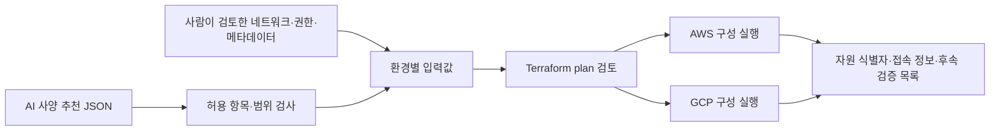

# Foxtrot IaC — AWS / GCP 프로비저닝 초안

**검토한 Terraform 구성을 플랫폼에 등록하고, AI는 허용된 사양·용량만 추천합니다.** 사람은 추천 근거와 plan을 확인한 후 실행합니다. 이 저장소는 해당 기반 모듈과 입력 계약을 제공합니다.

현재 버전: `v0.1` / PoC·개발 환경 전용. Kubernetes는 필요하지 않습니다.

## 무엇을 만드는가

| 역할 | AWS | GCP |
|---|---|---|
| 앱 서버 | EC2 + 고정 공인 IP | Compute Engine + 고정 공인 IP |
| 데이터베이스 | RDS PostgreSQL 16 | Cloud SQL PostgreSQL 16 |
| 캐시 | ElastiCache Redis 7.1 | Memorystore Redis 7.0 |
| 파일 저장소 | S3 | Cloud Storage |
| 네트워크 | 전용 VPC, public 앱 subnet, 2개 private 데이터 subnet, SG | 전용 VPC, 앱 subnet, Private Service Access, firewall |
| 앱 실행 권한 | 전용 IAM role / instance profile | 전용 service account, 키 파일 없음 |

두 구성은 역할이 대응하며, 엔진 세부 버전·성능·IAM·HA 동작까지 동일하다는 뜻은 아닙니다. 앱의 Redis 명령·PostgreSQL 확장 호환성은 별도 검증합니다.



AI 추천 API/모델 호출, 사용자 승인 UI, apply 실행기, 실제 비용 수집기는 이 초안의 범위 밖입니다. 추천 JSON을 받아 안전하게 입력 파일로 만드는 작은 도구는 포함합니다.

## 먼저 볼 파일

- [구조·선택 이유·네트워크 구성도](docs/design.md)
- [UI·실행 조정기 연동 인터페이스 명세](docs/provisioning-interface.md) — 팀 역할, 상태, 승인·오류 처리
- [OpenAPI 초안](contracts/provisioning.openapi.yaml) · [요청/응답 예시](contracts/examples/index.json) — 서버 미구현
- [입력, AI 추천, 태그·라벨 계약](docs/platform-contract.md)
- [실행·권한·state·삭제·검증 안내](docs/operations.md)
- [AWS 설정 예시](environments/aws/deployment.example.tfvars.json)
- [GCP 설정 예시](environments/gcp/deployment.example.tfvars.json)
- [AI 추천 가능 사양 목록](catalog/sizing-policy.json)

## 디렉터리

```text
environments/
  aws/                  # AWS root: provider, 변수, 모듈 연결, outputs, lock, tests
  gcp/                  # GCP root: 위와 동일, 별도 state로 실행
modules/
  metadata/             # 공통 식별·비용·보안 분류 메타데이터 검증
  aws/
    vpc/ security_groups/ iam/ ec2/ rds/ elasticache/ s3/
  gcp/
    network/ firewall/ iam/ compute/ cloud_sql/ memorystore/ storage/
catalog/                # 플랫폼/AI가 사용하는 사양 allowlist
examples/               # 추천 JSON, backend 설정 샘플
tools/render_inputs.py  # 입력 검사·추천값 병합 (Python 표준 라이브러리)
contracts/              # 프로비저닝 OpenAPI와 UI/팀 연동용 JSON 예시
tools/build_contract.py # 카탈로그를 반영한 명세·예시 생성기 (API 서버 아님)
tests/                  # AI 입력 경계·CIDR 검사 회귀 테스트
docs/                   # 설계·플랫폼 계약·운영 절차
```

각 서비스 모듈은 provider를 내부에서 설정하지 않습니다. root가 계정·리전을 결정하고 의존성을 연결합니다. 기존 state import나 클라우드 간 Terraform state 변환은 하지 않습니다.

## 기본 동작

- **앱 서버만 public:** 기본 웹 TCP 80/443 공개. 앱 설치·TLS 인증서는 별도 배포 작업입니다.
- **SSH는 기본 닫힘:** AWS는 SSM을 기본 관리 경로로 사용합니다. SSH가 필요하면 관리자 `/24~32` CIDR과 기존 key pair를 사람이 지정합니다. GCP는 OS Login 사용자 권한도 필요합니다.
- **데이터는 private:** DB·캐시에 공인 접속 경로를 만들지 않습니다. AWS는 앱 SG에서만 접근하도록 구성합니다. GCP는 전용 VPC/PSA와 앱 SA 대상 egress를 사용합니다.
- **암호화·인증:** DB TLS, Redis TLS+AUTH, 비공개 버킷, 저장소 버전 관리, 암호화 디스크.
- **데이터 보호:** DB 삭제 보호 기본 활성화, RDS final snapshot, Cloud SQL PITR, 비어 있지 않은 버킷 강제 삭제 금지.
- **PoC는 단일 서버:** HA DB/cache 선택은 가능하지만 앱까지 고가용성이 되는 것은 아닙니다.

## 로컬 검증 — 클라우드 자원 생성 없음

Terraform `>= 1.10, < 2`, Python `>= 3.10` 필요. 검증에 사용한 Terraform은 `1.13.5`이며 provider 버전은 각 root의 lock 파일에 고정합니다.

```bash
python -m pip install -r requirements-contracts.txt
python -m unittest discover -s tests -v
terraform fmt -check -recursive
terraform -chdir=environments/aws init -backend=false
terraform -chdir=environments/aws validate
terraform -chdir=environments/aws test
terraform -chdir=environments/gcp init -backend=false
terraform -chdir=environments/gcp validate
terraform -chdir=environments/gcp test
```

`terraform test`는 **mock provider + plan**만 사용합니다. 실제 계정/프로젝트에 접속해 가용성·할당량·네트워크 연결을 확인한 결과가 아닙니다. 실환경 apply나 마이그레이션은 수행하지 않았습니다.

## AI 추천 입력 예시

```json
{
  "cloud": "aws",
  "parameters": { "compute_instance_type": "t3.medium", "compute_disk_gib": 40 },
  "rationale": {
    "compute_instance_type": "실측 메모리 사용량을 바탕으로 검토할 후보",
    "compute_disk_gib": "이미지·로그 저장 공간에 대한 후보"
  }
}
```

```bash
python tools/render_inputs.py render --cloud aws \
  --base environments/aws/deployment.example.tfvars.json \
  --proposal examples/aws-recommendation.json \
  --output environments/aws/proposal.tfvars.json
```

이 명령은 baseline의 기존 값을 유지하면서 `sizing`의 허용 항목만 병합합니다. 파일은 새로만 생성하며 기존 승인 파일을 덮어쓰지 않습니다. 예시의 계정·프로젝트·bucket 이름·만료일은 실제 값으로 바꿔야 합니다. 상세 실행 절차는 [operations.md](docs/operations.md)를 따릅니다.

## 아직 결정할 것

- 첫 앱의 OS/image 고정값, 실제 부하와 리전별 사양 후보.
- 앱 DB 사용자/SQL GRANT·확장·스키마 초기화 담당. 현재 DB 생성과 초기 DB까지만 포함.
- 마이그레이션 runner의 위치, 원본↔대상 연결과 복제 전용 계정. 현재 네트워크에 VPN/복제 접근 예외는 없음.
- Redis가 유실 가능한 캐시인지 세션·큐 저장소인지. 이에 따라 데이터 이전 요구사항이 달라짐.
- 실행기 IAM 최소 권한 정책, 원격 state와 비밀 저장소, plan 승인 UI.
- 비용 수집·보안 점검 결과 저장소와 원본 자원 ID 연결 방식.

위 항목을 확정하지 않은 상태를 프로덕션 준비 완료로 표시하지 않습니다.
