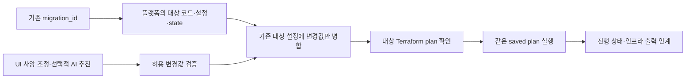

# Foxtrot IaC — AWS / GCP 프로비저닝 초안

**원본·이전 대상 환경의 배포 코드와 기본 설정은 이미 플랫폼이 관리합니다.** 사용자는 EC2 사양 같은 일부 값만 조정하고, 필요하면 AI 추천을 받아 대상의 Terraform plan을 확인·실행합니다. 이 저장소는 그 기반 모듈과 입력 계약을 제공합니다.

Terraform 모듈 `v0.1` / 연동 계약 `v0.3` / PoC·개발 환경 전용. Kubernetes는 필요하지 않습니다.

**새로: 첫 배포부터 IaC로.** 각 루트가 네트워크·데이터 저장소와 함께 레지스트리 이미지로 **실행 중인 앱**까지 만듭니다. `python -m provisioner up --org chiikawa --cloud aws` 한 줄, 또는 org·클라우드를 본문으로 받는 `POST /v1/environments` API로 띄웁니다. → [앱 환경 프로비저닝](docs/environment-provisioning.md)

## 무엇을 만드는가

| 역할 | AWS | GCP |
|---|---|---|
| 앱 서버 | EC2 + 고정 공인 IP, 부팅 때 ECR 이미지로 앱 실행 | Compute Engine + 고정 공인 IP, 부팅 때 Artifact Registry 이미지로 앱 실행 |
| 데이터베이스 | RDS PostgreSQL 17 (논리 복제) | Cloud SQL PostgreSQL 17 (논리 디코딩) |
| 캐시 | ElastiCache Redis 7.1 | Memorystore Redis 7.0 |
| 파일 저장소 | S3 | Cloud Storage |
| 네트워크 | 전용 VPC, public 앱 subnet, 2개 private 데이터 subnet, SG | 전용 VPC, 앱 subnet, Private Service Access, firewall |
| 앱 실행 권한 | 전용 IAM role / instance profile | 전용 service account, 키 파일 없음 |

두 구성은 역할이 대응하며, 엔진 세부 버전·성능·IAM·HA 동작까지 동일하다는 뜻은 아닙니다. 앱의 Redis 명령·PostgreSQL 확장 호환성은 별도 검증합니다.



앱 환경 plan/apply는 `provisioner/`가 실행합니다. AI 추천 API/모델 호출, 사용자 승인 UI, 실제 비용 수집기는 이 초안의 범위 밖입니다. 추천 JSON을 받아 안전하게 입력 파일로 만드는 작은 도구는 포함합니다.

## 먼저 볼 파일

- [main 통합과 준비 상태](docs/release-integration.md) — 기존 입력 호환, 인프라/앱 준비 구분, 공유 Tailscale, 관측 연결
- [클라우드 → 온프렘 설계](docs/on-prem-migration-design.md) — Ansible 실행기, 공통 입출력, 앱 스키마·준비 단계, 모듈별 수정 위치

- [앱 환경 프로비저닝](docs/environment-provisioning.md) — 앱 환경 생성·수정·삭제 CLI와 API
- [EC2 → GCE 전환·롤백 검증 기록](docs/compute-cloud-rehearsal.md) — 세션 요청 291건 성공, WebSocket·주문 확인, 임시 자원 정리
- [Notion 팀 공유 요약](https://app.notion.com/p/410b7958f327817b97c3faba860ec22b) — 검증 결과와 다음 통합 작업
- [COMPUTE 호출 방법](compute/README.md) — 컨트롤 플레인에서 계획 등록, 컨테이너 준비·기동, 결과 조회

- [치이카와 LIVE PoC 연결](docs/demo-deployment.md) — Redis 이전 설정, 관리망 입력, DB 초기 권한과 WebSocket
- [구조·선택 이유·네트워크 구성도](docs/design.md)
- [UI·실행 조정기 연동 인터페이스](docs/provisioning-interface.md) — 관리 중인 환경 전제, API 4개, 입출력·담당
- [OpenAPI 초안](contracts/provisioning.openapi.yaml) · [요청/응답 예시](contracts/examples/index.json) — 서버 미구현
- [입력, AI 추천, 태그·라벨 계약](docs/platform-contract.md)
- [실행·권한·state·삭제·검증 안내](docs/operations.md)
- [AWS 설정 예시](environments/aws/deployment.example.tfvars.json)
- [GCP 설정 예시](environments/gcp/deployment.example.tfvars.json)
- [AI 추천 가능 사양 목록](catalog/sizing-policy.json)

## 디렉터리

```text
environments/
  aws/                  # AWS root: provider, 변수, 모듈 연결, outputs, lock, tests
  gcp/                  # GCP root: 위와 동일, 별도 state로 실행
modules/
  metadata/             # 공통 식별·비용·보안 분류 메타데이터 검증
  aws/
    vpc/ security_groups/ iam/ ec2/ rds/ elasticache/ s3/
  app_runtime/          # 레지스트리 이미지로 앱을 띄우는 부팅 스크립트 (두 클라우드 공용)
  gcp/
    network/ firewall/ iam/ compute/ cloud_sql/ memorystore/ storage/
catalog/                # 플랫폼/AI가 사용하는 사양 allowlist
examples/               # 추천 JSON, backend 설정 샘플
tools/render_inputs.py  # 입력 검사·UI 변경값/추천값 병합 (Python 표준 라이브러리)
provisioner/            # 환경 생성 API·CLI: org·cloud 요청 → Terraform plan/apply/destroy (표준 라이브러리)
contracts/              # 프로비저닝 OpenAPI와 UI/팀 연동용 JSON 예시
tools/build_contract.py # 카탈로그를 반영한 명세·예시 생성기 (API 서버 아님)
tests/                  # AI 입력 경계·CIDR 검사 회귀 테스트
docs/                   # 설계·플랫폼 계약·운영 절차
```

각 서비스 모듈은 provider를 내부에서 설정하지 않습니다. root가 계정·리전을 결정하고 의존성을 연결합니다. 원본과 대상의 코드는 각각 관리하며, 기존 대상 자원은 기존 state로 plan/apply합니다. 인프라 탐지·코드 변환·환경 등록은 이 인터페이스의 범위가 아닙니다.

## 기본 동작

- **앱 서버만 public:** 기본 웹 TCP 80/443 공개. 앱은 부팅 스크립트가 컨테이너로 실행합니다. TLS 인증서는 Cloudflare Tunnel 또는 별도 작업입니다.
- **SSH는 기본 닫힘:** AWS는 SSM을 기본 관리 경로로 사용합니다. SSH가 필요하면 관리자 `/24~32` CIDR과 기존 key pair를 사람이 지정합니다. GCP는 OS Login 사용자 권한도 필요합니다.
- **데이터는 private:** DB·캐시에 공인 접속 경로를 만들지 않습니다. AWS는 앱 SG에서만 접근하도록 구성합니다. GCP는 전용 VPC/PSA와 앱 SA 대상 egress를 사용합니다.
- **암호화·인증:** DB TLS, 비공개 버킷, 저장소 버전 관리, 암호화 디스크. Redis TLS·AUTH는 선택이며 기본은 꺼짐입니다. 팀 Redis 프록시가 TLS 백엔드를 지원하지 않기 때문이고, 접근은 SG·VPC로 제한합니다.
- **데이터 보호:** DB 삭제 보호 기본 활성화, RDS final snapshot, Cloud SQL PITR, 비어 있지 않은 버킷 강제 삭제 금지.
- **PoC는 단일 서버:** HA DB/cache 선택은 가능하지만 앱까지 고가용성이 되는 것은 아닙니다.

## 로컬 검증 — 클라우드 자원 생성 없음

Terraform `>= 1.10, < 2`, Python `>= 3.10` 필요. 검증에 사용한 Terraform은 `1.13.5`이며 provider 버전은 각 root의 lock 파일에 고정합니다.

```bash
python -m pip install -r requirements-contracts.txt -r requirements-onprem.txt -r requirements-observability.txt
python -m unittest discover -s tests -v
terraform fmt -check -recursive
terraform -chdir=environments/aws init -backend=false
terraform -chdir=environments/aws validate
terraform -chdir=environments/aws test
terraform -chdir=environments/gcp init -backend=false
terraform -chdir=environments/gcp validate
terraform -chdir=environments/gcp test
```

`terraform test`는 **mock provider + plan**으로 전체 환경 구성을 점검합니다. EC2·GCE 모듈은 별도로 실제 계정에 배포해 팀 데모의 웹 트래픽 전환과 롤백을 확인했습니다. [측정 결과와 자원 정리 기록](docs/compute-cloud-rehearsal.md)

## AI 추천 입력 예시

```json
{
  "cloud": "aws",
  "parameters": { "compute_instance_type": "t3.medium", "compute_disk_gib": 40 },
  "rationale": {
    "compute_instance_type": "실측 메모리 사용량을 바탕으로 검토할 후보",
    "compute_disk_gib": "이미지·로그 저장 공간에 대한 후보"
  }
}
```

```bash
python tools/render_inputs.py render --cloud aws \
  --base environments/aws/deployment.example.tfvars.json \
  --proposal examples/aws-recommendation.json \
  --output environments/aws/proposal.tfvars.json
```

이 명령은 baseline의 기존 값을 유지하면서 `sizing`의 허용 항목만 병합합니다. 파일은 새로만 생성하며 기존 승인 파일을 덮어쓰지 않습니다. 예시의 계정·프로젝트·bucket 이름·만료일은 실제 값으로 바꿔야 합니다. 상세 실행 절차는 [operations.md](docs/operations.md)를 따릅니다.

## 아직 결정할 것

- 첫 앱의 OS/image 고정값, 실제 부하와 리전별 사양 후보.
- 앱 DB 사용자/SQL GRANT·확장·스키마 초기화 담당. 현재 DB 생성과 초기 DB까지만 포함.
- 마이그레이션 runner의 위치, 원본↔대상 연결과 복제 전용 계정. 현재 네트워크에 VPN/복제 접근 예외는 없음.
- Redis가 유실 가능한 캐시인지 세션·큐 저장소인지. 이에 따라 데이터 이전 요구사항이 달라짐.
- 실행기 IAM 최소 권한 정책, 원격 state와 비밀 저장소, plan 승인 UI.
- 비용 수집·보안 점검 결과 저장소와 원본 자원 ID 연결 방식.

위 항목을 확정하지 않은 상태를 프로덕션 준비 완료로 표시하지 않습니다.

## 마이그레이션 관측

실제 PLAN/APPLY와 COMPUTE 준비 결과를 컨트롤 플레인으로 보고하는 방법은 [관측 연결](docs/migration-observability.md)을 참고하세요.

온프렘 실행 설정: [개인 PC 한 대 준비](docs/on-prem-setup.md) · [v2 API](contracts/onprem.openapi.yaml). 기존 AWS/GCP v1 API와 별도로 Ansible 경로를 제공한다.

### Application system telemetry

`appTelemetry` sets the OTLP HTTP `endpoint`, server-managed `applicationId` (from the loaded migration seed; no hardcoded demo name), and `headersSecrets` (`aws` Secrets Manager ARN / `gcp` Secret Manager resource). Platform Terraform copies the exporter header secret into GCP and injects both references. App requests cannot override OTEL settings.

The provisioner injects `OTEL_OWNER_ID` from the persisted organization and `OTEL_DEPLOYMENT_ID` from the deployment record. The updated demo image collects its container cgroup CPU, memory and disk I/O. Docker VM and on-prem app containers use an isolated network; no host agent or host filesystem mount is installed. On-prem exporter credentials come from the control-plane OTLP environment or `appTelemetry.endpoint` / `headersEnv`; nodes must reach the collector privately.

Managed Fargate / Cloud Run app containers share a network namespace within one app instance. Their config sets `OTEL_NETWORK_SCOPE=app-instance`; only the API container reports network counters, which include its app workers and tunnel. CPU/memory/I/O remain container-scoped; missing kernel counters or resource limits remain missing. Shared filesystem capacity is not reported. Existing deployments need the updated image and configuration; changing this repository does not redeploy them.
