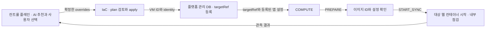

# COMPUTE · 컨테이너 앱 준비

IaC와 COMPUTE를 이 저장소에서 함께 관리한다. IaC는 **어느 VM에 올릴지**, COMPUTE는 **그 VM에 어떤 앱을 언제 띄울지** 책임진다. 첫 PoC는 같은 CPU 아키텍처의 Linux VM 두 대와 웹 컨테이너 하나를 사용한다.



### 컨트롤 플레인과 주고받는 값

| 단계 | 입력 | 결과 |
|---|---|---|
| 사양 선택 | 이미 관리하는 대상 환경 | IaC가 현재 사양과 허용 범위를 제공. 컨트롤 플레인이 AI 추천과 사용자 선택을 처리 |
| 인프라 준비 | 예: `{"overrides":{"compute_machine_type":"e2-medium"}}` | 기존 state로 계획하고 승인 후 적용. 변경 0건도 기존 VM 출력을 인계 |
| 자원 등록 | `handoff.outputs.compute`와 대상 환경 ID | 플랫폼이 계정·리전 범위에서 실제 VM을 하나의 `targetRef`에 연결. 재실행 시 같은 VM 참조를 사용 |
| 앱 계획 | `kind=COMPUTE`, `sourceRef`, `targetRef`, `workloadScopeRef`, `bindingRef` 등 공통 계획 필드 | source에서 확인한 이미지 ID, 대상 설정 버전과 앱 진입점 참조를 계획에 고정 |
| 앱 준비 | 등록된 targetRef와 PREPARE / START_SYNC | 이미지·설정 확인 결과, 실행한 컨테이너 ID와 VM 내부 HTTP 점검 결과 |

프로비저닝 입력은 `tools/render_inputs.py context`로 조회하고, 컨트롤 플레인이 확정한 plan 요청 JSON은 `render-overrides`로 검증·병합한다. 두 명령에 대한 예시는 [프로비저닝 계약](../docs/provisioning-interface.md)에 있다. Terraform의 `INFRA_APPLIED`는 COMPUTE를 호출할 수 있는 시점이다.

### 레지스트리 없이 웹 컨테이너 준비하기

이 [실행기](runner.py)는 **대상 VM 안에서** 실행한다. 운영자가 준비한 Docker Engine, Python 3.10+, 같은 아키텍처의 이미지, 버전이 고정된 환경 파일이 필요하다. PoC에서 이미지 전달은 수동이다.

1. 원본의 실행 중인 웹 컨테이너에서 `docker inspect --format '{{.Image}}' SOURCE_WEB`로 전체 이미지 ID를 기록한다. 이 ID로 `docker image save -o demo.docker.tar IMAGE_ID`를 실행해 승인된 관리 경로로 대상 VM에 전달한다.
2. 대상 VM에서 `docker image load -i demo.docker.tar`를 실행한다. [binding.example.json](binding.example.json)을 `binding.local.json`으로 복사하고 원본의 이미지 ID와 해당 VM에 등록된 `targetRef`를 넣는다. `configVersion`은 이미지 실행 인자와 비밀값 참조 버전을 포함해 고정하고, 변경 시 새 버전을 발급한다. `envFile`은 해당 버전의 읽기 제한된 파일을 가리킨다. 원본과 대상의 프록시·객체 경로는 **현재 활성 위치**에 맞춘다.
3. 아래 두 명령을 순서대로 실행한다. 예제는 데모 웹의 실행 명령과 `/readyz`를 사용한다. Worker는 별도 프로세스로 관리하고, 대상 진입점은 업무 트래픽에서 제외해 둔다.

```bash
python compute/runner.py PREPARE --target-ref resource:gcp-demo-web --binding compute/binding.local.json
python compute/runner.py START_SYNC --target-ref resource:gcp-demo-web --binding compute/binding.local.json
```

실행기는 고정한 이미지 ID로 웹 컨테이너 한 개를 만들고 VM의 loopback 임시 포트로 HTTP 200을 확인한다. 같은 설정으로 다시 호출하면 기존 컨테이너를 확인한다. 이름 충돌, 종료된 컨테이너, 점검 실패는 운영자가 상태를 확인할 수 있게 남긴다. 이때 앱 시작 코드 자체의 외부 쓰기는 발생할 수 있다. 데모 앱은 시작 시 DB 스키마를 초기화하므로 대상 환경에서 DDL 권한·실행 시점을 먼저 합의한다. 웹 프로세스 안에서 큐 소비나 예약 작업을 시작하는 앱은 그 기능을 비활성화할 수 있어야 한다.

### 컨트롤 플레인에서 호출하기

대상 VM에서 [HTTP 어댑터](server.py) 한 개를 실행한다. 시작할 때 IaC APPLY 결과의 [handoff 형식](../contracts/examples/gcp-handoff-response.json)과 로컬 binding을 읽어 `targetRef`를 대상 환경·VM ID·설정 버전에 연결한다. 플랫폼은 이 VM의 어댑터 주소를 관리한다. `workflowId`는 handoff의 `migration_id`를 사용한다.

```bash
# 대상 VM의 저장소 루트에서 실행. COMPUTE_TOKEN은 서비스 환경에서 주입한다.
python -m compute.server --handoff /etc/foxtrot/handoff.json \
  --binding /etc/foxtrot/binding.json --db /var/lib/foxtrot/compute.db
```

어댑터는 `127.0.0.1:8787`에서 수신한다. 컨트롤 플레인은 기존 관리 터널 또는 사설 HTTPS 프록시를 통해 호출한다. 같은 VM에서 직접 확인할 때는 아래 명령을 사용한다. 실환경에서는 [계획 예시](plan.example.json)의 참조를 등록값으로 바꾼다.

```bash
base=http://127.0.0.1:8787/v1
auth="Authorization: Bearer ${COMPUTE_TOKEN}"
curl -fsS -H "$auth" "$base/capabilities"
curl -i -H "$auth" -H 'Content-Type: application/json' -H 'Idempotency-Key: create-demo-1' \
  --data @compute/plan.example.json "$base/migrations"
```

| 호출 | 다음에 사용할 값 |
|---|---|
| `POST /v1/migrations` | `201`. 응답의 `migrationId`와 `revision` 보관 |
| `POST /v1/migrations/{id}/actions` | `{"action":"PREPARE","expectedRevision":1}`와 새 Idempotency-Key를 전달. `202` 응답의 `Location` 조회 |
| `GET /v1/operations/{id}` | `SUCCEEDED`이면 migration 재조회. `FAILED`·`UNKNOWN`이면 상태와 허용된 복구 명령 확인 |
| `GET /v1/migrations/{id}` | 최신 revision과 allowedActions로 `START_SYNC` 요청. 완료된 operation에서 컨테이너 ID와 VM 내부 probePort 확인 |

모든 호출은 Bearer 인증을 사용한다. 응답을 잃으면 **같은 키와 본문**으로 재시도한다. SQLite에 접수와 실행 의도를 함께 보관하고 대상에서 명령을 하나씩 실행한다. 서비스는 VM당 한 프로세스로 운영하고 DB 파일을 영속 디스크에 둔다. 재시작 시 대기 작업은 이어서 실행하고, 실행 중 끊긴 작업은 UNKNOWN으로 기록한다. RECONCILE은 기존 이미지·컨테이너를 읽고 점검한다. 시작하지 않았거나 종료된 컨테이너는 관리자가 확인한다.

**준비 완료의 의미.** 이 프로필은 원본과 같은 웹 이미지가 대상에서 HTTP 200을 반환하는 지점까지 제공한다. START_SYNC 성공 후 lifecycle은 SYNCING, readiness.advance는 UNKNOWN이다. 어댑터가 업무 쓰기 차단을 독립 관측하기 전에는 targetWritesPossible을 보수적으로 true로 반환한다. 팀 데모의 최종 업무 검증에는 원본 Worker가 실행 중인 격리 환경에서 [데모의 check_live.py](https://github.com/SoftBank-2026-Hackathon-Foxtrot/demo/blob/bc9b691/scripts/check_live.py)를 사용한다. 이 검사는 테스트 메시지와 주문을 생성한다.

다음 통합은 관리망 연결, 운영용 업무 정지 근거, 트래픽 어댑터를 통한 진입점 변경이다. QUIESCE·CUTOVER·RESUME은 해당 제어와 검증이 연결되면 프로필에 추가한다. 공통 계약은 [팀 설계 초안 0.2](https://app.notion.com/p/Design-Doc-2-40fb7958f32780ee9403e6284e1c3210)와 [object-migration](https://github.com/SoftBank-2026-Hackathon-Foxtrot/object-migration/blob/75da4f001d573e8a03bf6d7b98214334ef5d46d9/api/openapi.yaml)을 따른다.
