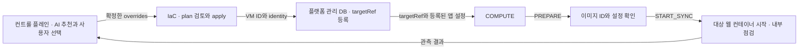

# COMPUTE · 컨테이너 앱 준비

IaC와 COMPUTE를 이 저장소에서 함께 관리한다. IaC는 **어느 VM에 올릴지**, COMPUTE는 **그 VM에 어떤 앱을 언제 띄울지** 책임진다. 첫 PoC는 같은 CPU 아키텍처의 Linux VM 두 대와 웹 컨테이너 하나를 사용한다.



### 컨트롤 플레인과 주고받는 값

| 단계 | 입력 | 결과 |
|---|---|---|
| 사양 선택 | 이미 관리하는 대상 환경 | IaC가 현재 사양과 허용 범위를 제공. 컨트롤 플레인이 AI 추천과 사용자 선택을 처리 |
| 인프라 준비 | 예: `{"overrides":{"compute_machine_type":"e2-medium"}}` | 기존 state로 계획하고 승인 후 적용. 변경 0건도 기존 VM 출력을 인계 |
| 자원 등록 | `handoff.outputs.compute`와 대상 환경 ID | 플랫폼이 계정·리전 범위에서 실제 VM을 하나의 `targetRef`에 연결. 재실행 시 같은 VM 참조를 사용 |
| 앱 계획 | `kind=COMPUTE`, `sourceRef`, `targetRef`, `workloadScopeRef`, `bindingRef` 등 공통 계획 필드 | source에서 확인한 이미지 ID, 대상 설정 버전과 앱 진입점 참조를 계획에 고정 |
| 앱 준비 | 등록된 targetRef와 PREPARE / START_SYNC | 이미지·설정 확인 결과, 실행한 컨테이너 ID와 VM 내부 HTTP 점검 결과 |

프로비저닝 입력은 `tools/render_inputs.py context`로 조회하고, 컨트롤 플레인이 확정한 plan 요청 JSON은 `render-overrides`로 검증·병합한다. 두 명령에 대한 예시는 [프로비저닝 계약](../docs/provisioning-interface.md)에 있다. Terraform의 `INFRA_APPLIED`는 COMPUTE를 호출할 수 있는 시점이다.

### 레지스트리 없이 웹 컨테이너 준비하기

이 [실행기](runner.py)는 **대상 VM 안에서** 실행한다. 운영자가 준비한 Docker Engine, Python 3.10+, 같은 아키텍처의 이미지, 버전이 고정된 환경 파일이 필요하다. PoC에서 이미지 전달은 수동이다.

1. 원본의 실행 중인 웹 컨테이너에서 `docker inspect --format '{{.Image}}' SOURCE_WEB`로 전체 이미지 ID를 기록한다. 이 ID로 `docker image save -o demo.docker.tar IMAGE_ID`를 실행해 승인된 관리 경로로 대상 VM에 전달한다.
2. 대상 VM에서 `docker image load -i demo.docker.tar`를 실행한다. [binding.example.json](binding.example.json)을 `binding.local.json`으로 복사하고 원본의 이미지 ID와 해당 VM에 등록된 `targetRef`를 넣는다. `configVersion`은 이미지 실행 인자와 비밀값 참조 버전을 포함해 고정하고, 변경 시 새 버전을 발급한다. `envFile`은 해당 버전의 읽기 제한된 파일을 가리킨다. 원본과 대상의 프록시·객체 경로는 **현재 활성 위치**에 맞춘다.
3. 아래 두 명령을 순서대로 실행한다. 예제는 데모 웹의 실행 명령과 `/readyz`를 사용한다. Worker는 별도 프로세스로 관리하고, 대상 진입점은 업무 트래픽에서 제외해 둔다.

```bash
python compute/runner.py PREPARE --target-ref resource:gcp-demo-web --binding compute/binding.local.json
python compute/runner.py START_SYNC --target-ref resource:gcp-demo-web --binding compute/binding.local.json
```

실행기는 고정한 이미지 ID로 웹 컨테이너 한 개를 만들고 VM의 loopback 임시 포트로 HTTP 200을 확인한다. 같은 설정으로 다시 호출하면 기존 컨테이너를 확인한다. 이름 충돌, 종료된 컨테이너, 점검 실패는 운영자가 상태를 확인할 수 있게 남긴다. 이때 앱 시작 코드 자체의 외부 쓰기는 발생할 수 있다. 데모 앱은 시작 시 DB 스키마를 초기화하므로 대상 환경에서 DDL 권한·실행 시점을 먼저 합의한다. 웹 프로세스 안에서 큐 소비나 예약 작업을 시작하는 앱은 그 기능을 비활성화할 수 있어야 한다.

### 다음 구현 순서와 완료 기준

| 순서 | 맡을 곳 | 완료 기준 |
|---|---|---|
| 1 | 플랫폼 + IaC | 기존 환경 조회 → 확정 사양 병합 → 승인된 saved plan 적용 → handoff를 targetRef에 저장. 대상 변경 0건으로도 앱 준비 진행 |
| 2 | COMPUTE | 서비스 인증 후 공통 API로 계획 등록(`201`), 액션 접수(`202 + Location`), operation·migration 조회. 관리 DB의 참조로 대상과 설정을 해석하고 승인된 원격 실행 경로로 이 실행기를 호출 |
| 3 | COMPUTE + 앱 담당 | 중복 접수·revision 검사, 대상별 실행 직렬화, 재시작 후 실제 컨테이너 대조. 상태 불명이면 UNKNOWN → RECONCILE. 앱 경유 DB·Redis·객체 접근과 Worker 중지를 검사한 뒤 준비 판정 |
| 4 | COMPUTE + 트래픽 + 오케스트레이터 | QUIESCE로 요청·Worker 배수, CUTOVER로 진입점 변경·검증, RESUME으로 업무 재개. 원본 복귀 전 현재 데이터 경로와 호환성 검증 |

현재 제공하는 것은 **대상 VM용 준비 실행기**다. HTTP 어댑터를 붙일 때 [object-migration 구현](https://github.com/SoftBank-2026-Hackathon-Foxtrot/object-migration/blob/75da4f001d573e8a03bf6d7b98214334ef5d46d9/api/openapi.yaml)의 공통 경로와 [팀 설계 초안 0.2](https://app.notion.com/p/Design-Doc-2-40fb7958f32780ee9403e6284e1c3210)를 따른다. 작업 요청에는 등록 ID만 받고 로컬 파일 경로·명령·Secret은 대상 측에서 해석한다. 실행기의 HTTP 200 관측은 한 개의 점검 근거이며, 전체 준비 판정과 트래픽 변경은 이후 단계에서 수행한다.
