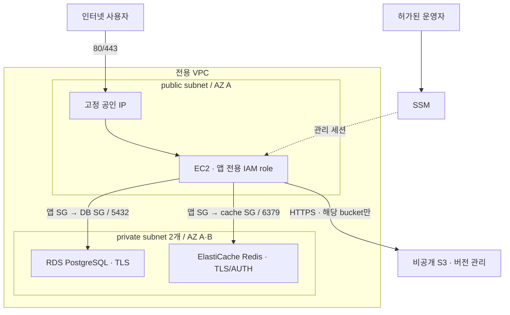
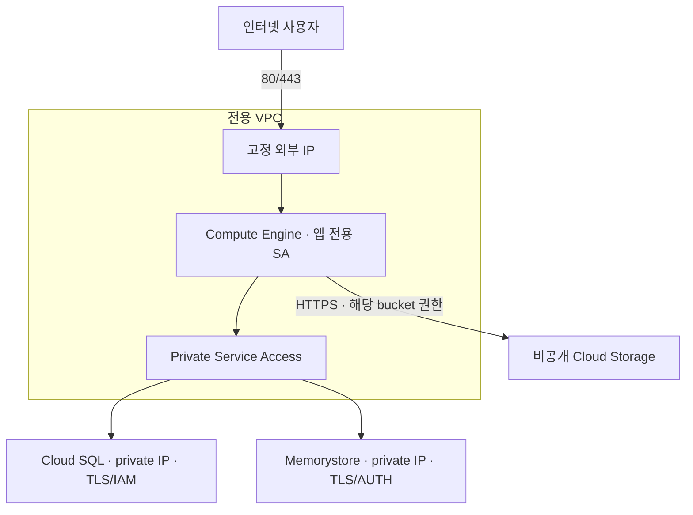

# 설계 초안: 검토된 구성 + 제한된 사양 추천

## 목표와 경계

원본·이전 대상 환경의 AWS/GCP IaC, 기본 설정, state 연결은 플랫폼에서 이미 관리되고 있다는 전제입니다. 여기서는 기존 대상 구성에 인스턴스·DB·캐시 사양과 용량 변경값만 반영합니다. AI는 해당 값의 추천을 돕습니다. HCL, IAM 정책, CIDR, 공개 여부, 엔진 major, 삭제 정책은 이 UI/API의 변경 대상이 아닙니다.

인프라 자동 탐지, 임의 AWS→GCP 변환, 앱 설치, 데이터 복제, 트래픽 전환은 이 범위에 포함하지 않습니다. `apply 성공`은 대상 인프라 반영 완료이며 앱 readiness나 무중단 이전 완료를 뜻하지 않습니다. [연동 계약 v0.2](provisioning-interface.md)는 기존 migration_id와 일부 변경값으로 plan/apply하는 5개 API만 제안합니다.

아래 구성도는 양쪽 환경에 미리 마련할 기본 IaC입니다. 환경 등록·구조 설계를 마이그레이션마다 사용자에게 반복시키지 않습니다. 대상 자원이 이미 있으면 그 state를 그대로 사용합니다.

## AWS 구성

public subnet에만 인터넷 기본 route가 있습니다. private subnet에는 IGW/NAT route를 넣지 않습니다. NAT Gateway는 이 워크로드에 필수적이지 않아 기본 생성하지 않습니다. EC2 outbound는 HTTPS 및 데이터 SG 대상 포트입니다. 앱 설치 시 HTTP 패키지 저장소나 별도 API 포트가 필요하면 사람이 요구사항을 검토해 규칙을 변경합니다.

## GCP 구성

GCP에는 AWS public/private subnet을 그대로 복제하지 않습니다. VM의 외부 IP, firewall, 관리형 서비스용 PSA 범위로 공개·내부 경로를 구분합니다. 관리형 DB/cache는 고객 subnet 내부 VM이 아닙니다.

앱 SA를 대상으로 ingress와 egress를 설정합니다. Cloud SQL connector는 대상 3307/관리 API 443, 직접 DB 연결은 5432, Memorystore TLS는 6378입니다. DNS/metadata 같은 Google 플랫폼 고유 경로도 실환경에서 확인해야 합니다.

**GCP 제한:** 이 구성은 전용 VPC에 지정 앱 VM만 존재한다는 가정입니다. 다른 워크로드를 추가했을 때 앱 SA만 DB에 접근 가능한 완전한 네트워크 격리를 보장하지 않습니다. 해당 경우 전체 VPC firewall/egress 정책과 DB 권한을 함께 검토해야 합니다. AWS SG 참조와 GCP managed-service 접근을 동일하게 취급하지 않습니다.

## 모듈 책임

| 계층 | 책임 | 입력 변경 주체 |
|---|---|---|
| 공통 metadata | 추적 필드 형식, 필수 분류, 템플릿 버전 | 사람/플랫폼 |
| 네트워크·SG/firewall | 연결 경로, 공개 포트, CIDR | 사람 |
| IAM | 앱 실행 identity와 최소 기능별 권한 | 사람 |
| 서버·DB·캐시 | 사양과 고정된 보안 기본값으로 자원 생성 | sizing만 AI 추천 가능 |
| 저장소 | 비공개 객체 저장소, 버전 관리 | 사람 |
| 환경 root | 입력 검증, provider, 모듈 연결, 인계 출력 | 플랫폼 |

서비스별 state를 과도하게 쪼개지 않고 **배포·클라우드별 root state**를 사용합니다. AWS/GCP에 같은 state를 공유하지 않습니다. 모듈 분리와 state 분리는 다른 결정입니다.

## IAM 초안

| 주체 | 포함하는 권한 | 포함하지 않는 것 |
|---|---|---|
| AWS 앱 role | 자기 S3 bucket의 객체 CRUD/list, SSM 관리 agent 권한 | 계정 admin, IAM 변경, RDS master secret 읽기 |
| GCP 앱 SA | 자기 GCS bucket의 objectUser, logging/metrics 쓰기, Cloud SQL client/instanceUser | owner/editor, SA key 생성, 프로젝트 IAM 변경 |
| Terraform 실행 주체 | 외부에서 공급받음. 이 코드가 만들지 않음 | 앱 role과 공유하지 않음 |

GCP Cloud SQL 역할은 현재 프로젝트 범위입니다. 이 초안은 전용 PoC 프로젝트를 가정하며 공유 프로젝트에서는 대상 instance 범위로 제한 가능한 조건/커스텀 역할을 검토해야 합니다. IAM DB 로그인 허용과 SQL 테이블 권한은 별개입니다.

운영자 AWS SSM 권한, GCP OS Login/SA 사용 권한, Redis AUTH 전달 권한은 플랫폼 운영 측에서 별도로 부여합니다. root 실행 권한 목록은 `operations.md`를 참고하되 조직용 최소 권한 정책이 검증된 상태는 아닙니다.

## 데이터와 초기 설정

- RDS: DB 인스턴스·초기 DB·TLS parameter group, AWS가 관리하는 master secret 참조. 앱용 제한 계정과 비밀 전달은 후속 bootstrap 담당.
- Cloud SQL: DB 인스턴스·초기 DB·앱 IAM DB 사용자. 앱은 private IP 모드의 connector/proxy와 IAM 인증을 설정해야 하며 SQL GRANT는 후속 bootstrap 담당.
- Redis: 인증·TLS 자원만 준비. AWS token은 별도 secret injection, GCP AUTH는 허가된 bootstrap 주체가 조회·전달. 앱 role에 master/admin 권한을 자동 추가하지 않음.
- 테이블/확장/논리 복제 플래그·DDL·데이터 복제는 DB 팀과 결정 후 추가. 이번 초안은 복제 준비 완료가 아님.

## 검증과 한계

모듈 스키마, root 조합, 보안 기본값, 실패 입력을 로컬·CI에서 검사합니다. mock 테스트로 실제 리전의 machine availability, quota, 조직 정책, DB patch 지원, IAM 전파 시간이나 실제 연결을 증명할 수는 없습니다.

프로덕션으로 확장하려면 private 앱 계층, LB/TLS, 복수 앱 서버, 실제 backup restore, 운영 알림, workload 접근 통제, 데이터 전환·복구 절차를 별도로 설계해야 합니다. 이 범위를 현재 PoC 구현으로 주장하지 않습니다.
