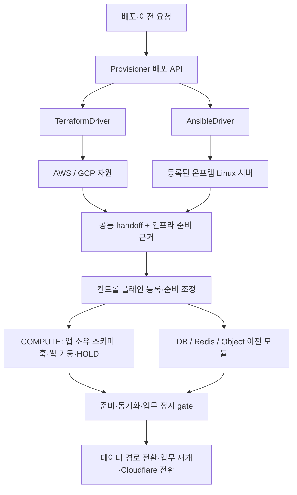

# 클라우드 → 온프레미스 마이그레이션 설계

2026-11-07 · 설계 및 1차 구현 · 호스트·데이터 서비스 준비는 구현, 마이그레이션 연결은 후속 단계

[개인 PC 한 대 설정 및 구현 범위](on-prem-setup.md)

[Notion 설계 문서](https://app.notion.com/p/411b7958f32781dabecec0c05041f4e6)

## 1. 결정

기존 **Provisioner(환경을 준비하는 배포 API)** 안에서 실행기를 분리한다. AWS/GCP는 기존 Terraform 실행기를 사용하고, 온프렘은 Ansible 실행기를 사용한다. 컨트롤 플레인과 데이터 이전 모듈은 실행 도구 대신 **대상 식별자, 연결 정보, 준비 상태**를 받는다.

배포 위치와 실행 도구는 별도 필드로 둔다. 온프렘에서도 vSphere처럼 Terraform provider가 있는 환경은 Terraform을 사용할 수 있다. 이번 범위는 **이미 할당된 Linux 서버를 Ansible로 구성하는 방식**이다. VM 생성·OS 설치·하이퍼바이저 연동은 포함하지 않는다. [vSphere provider](https://github.com/vmware/terraform-provider-vsphere)

첫 구현의 범위는 다음과 같다.

- 관리 서버와 컨트롤 플레인은 현재 위치에 유지한다. 온프렘에는 앱과 대상 데이터 서비스를 배치한다.
- 기존 개인 PC 한 대 또는 Linux 서버/VM에서 Docker와 원본 이미지와 같은 CPU 아키텍처를 사용한다. 기존 작업과 공존하는 전용 runtime 디렉터리를 관리한다. PoC 기본은 Ubuntu 24.04 / amd64다.
- 대상 서비스는 PostgreSQL 17, Valkey 8, SeaweedFS다. 정확한 이미지 digest와 설정 버전은 승인된 배포 프로필에 고정한다.
- 기존 Redis·오브젝트·트래픽 모듈을 연결한다. DB에는 클라우드 PostgreSQL → 자체 운영 PostgreSQL용 프로필을 추가한다.
- 업무 테이블은 앱이 만든다. Ansible은 DB 서비스·계정·접근 권한까지만 준비한다.
- 인프라 준비, 앱 기동, 데이터 동기화, 트래픽 전환을 별도로 판정한다. 앱 `READY`만으로 컷오버하지 않는다.

## 2. 코드에서 확인한 재사용 범위와 공백

| 영역 | 현재 코드 | 추가할 내용 |
|---|---|---|
| IaC 배포 API | `provisioner/service.py`가 Terraform을 직접 호출. `spec.py`는 AWS/GCP 입력만 처리 | 실행기 인터페이스, 온프렘 inventory와 입력 검증 |
| COMPUTE | 로컬 Docker에서 이미지·설정 확인과 웹 기동 가능. `compute/adapter.py`의 handoff 등록은 AWS/GCP만 허용 | 공통 handoff 수용, 앱 스키마 준비 훅, 초기 HOLD, 대상 서비스 경로 연결 |
| DB | `SELF_MANAGED` 등록 형식은 있음. 운영 논리 복제는 `AWS_RDS → GCP_CLOUDSQL`만 허용. 자체 운영 랩 프로필은 양쪽 SELF_MANAGED PG18 전제 | 클라우드 PG17 → 자체 운영 PG17 프로필과 provider별 권한/신원 검증 |
| Redis | `onprem/`에 Valkey 구성, `onprem` endpoint 등록·전환 예제 있음 | Ansible 배포 연결, app/admin 자격 분리, 재시작 후 ACL·AOF 확인 |
| 오브젝트 | `seaweedfs` endpoint, S3 gateway와 filer feed, 양방향 이전 기록 있음 | 기존 compose 배포 연결, bucket·자격·filer 주소 등록 |
| 트래픽 | `CF_POOL_IDS`는 환경 이름 → pool ID 사전. AWS/GCP enum으로 제한하지 않음 | 온프렘 tunnel/origin/pool 등록, 전체 pool 가중치 유지 |
| 컨트롤 플레인 | 환경 사전과 resource ref 중심. 데이터 모듈의 capabilities를 확인 | 대상 준비 결과 → 환경/리소스 등록 연결, 새 DB 프로필, 초기 HOLD와 준비 gate |
| 프록시 | PgBouncer·Redis proxy·오브젝트 routing을 통해 활성 위치를 변경 | 온프렘에서도 도달 가능한 주소/DNS/인증, 우회 쓰기 차단 확인 |

**DB는 주소만 바꿔서 사용할 수 없다.** `db-migration-adaptor/src/db_operator/service.py`와 `logical.py`가 공급자 조합을 검사한다. 현재 랩 프로필을 클라우드 DB에 억지로 적용하거나 기존 검사만 제거하지 않는다.

또한 최신 control-plane main에는 역방향 CDC의 capability 확인과 롤백 흐름이 추가되어 있지만, 확인한 DB main의 운영 프로필은 `BEFORE_TARGET_WRITE`만 제공한다. 첫 온프렘 프로필도 이 정책으로 시작한다. 컨트롤 플레인에 롤백 버튼이 있다는 이유로 역복제 지원을 추정하지 않는다.

## 3. 전체 구조와 책임



| 담당 | 소유하는 것 |
|---|---|
| Provisioner | 서버 선택·예약, 실행 작업, 서비스 설치/설정, 공통 연결 정보, 인프라 준비 근거 |
| COMPUTE / 앱 | 이미지·설정, 앱이 제공하는 schema-only 실행, 웹·워커 시작 모드, 앱 기동 근거 |
| 데이터 이전 모듈 | 복제, 정합성 검사, 쓰기 차단, 각 프록시/데이터 경로 변경, 해당 자원의 롤백 판단 |
| 컨트롤 플레인 | 위 결과의 연결, workload HOLD/RESUME, 단계 진행과 실패 복구 결정 |
| traffic | 기존 Cloudflare LB의 pool 가중치 변경과 실제 상태 확인 |

Ansible playbook에서 DB 복제·Redis 컷오버·Cloudflare 가중치 변경까지 실행하지 않는다. 데이터 이전 명령의 재시도·관측·복구는 기존 모듈에 남긴다. 새 온프렘 경로의 앱 컨테이너는 COMPUTE가 소유하고 Ansible은 런타임·어댑터 설치까지만 한다. 같은 앱을 두 실행기가 각각 띄우지 않는다. 기존 v1 클라우드 부팅 방식은 유지한다.

기존 COMPUTE `container-stage-v1`의 웹 준비 의미도 유지한다. 새 `container-stage-v2`에서 PREPARE는 이미지/설정 확인과 앱 소유 schema 훅, START_SYNC는 웹·worker의 HOLD 기동을 제공한다. schema 훅 실행 기록과 버전을 저장해 결과 불명 시 임의 재실행하지 않는다. 업무 재개는 COMPUTE가 아니라 CP의 workload 명령으로 수행한다.

## 4. 필요한 인터페이스

### 4.1 대상 등록: 위치와 서버 목록

첫 버전은 별도 inventory 서비스 없이 운영자가 관리하는 버전 고정 파일을 사용한다. API는 `inventoryRef`만 받으며 SSH 주소·개인키·임의 playbook·원시 Ansible 변수를 받지 않는다.

| 필드 | 내용 |
|---|---|
| `siteRef` | 온프렘 사이트 식별자. 예: `site:seoul-lab` |
| `inventoryRef` | 해당 조직이 사용할 수 있는 서버 목록과 불변 revision |
| `hosts` | host ID, 관리 주소, SSH port/user, 검증한 host key, 역할(app/db/cache/object/router), 예약 정보 |
| `credentialRefs` | SSH·become·registry·DB·서비스 자격의 참조와 버전. 값은 작업 실행 시만 해석 |
| `network` | 사이트/관리/클라우드 CIDR, 라우터 참조, DNS, 허용 연결 |
| `capacity` | 최소 CPU/RAM/가용 디스크, 데이터 경로, 사용 중인 포트. 배포 사전 검사에 사용 |

한 서버에 여러 역할을 배치할 수 있다. 첫 버전은 등록한 호스트를 환경 하나에 예약한다. 개인 PC의 기존 컨테이너와 공존할 수 있지만, 관리할 runtime 디렉터리·서비스 포트·데이터 소유권이 충돌하면 중단한다. 서버를 새로 생성했다는 뜻으로 기록하지 않는다. 기존 DB/스토리지 채택은 별도 모드로 후속 확장한다.

사이트의 첫 관리 경로는 사전 조건이다. 기존 VPN/SSH 경로 또는 현장에서 1회 수행한 Tailscale bootstrap으로 라우터에 접근할 수 있어야 한다. 접근할 수 없는 서버에 중앙 Ansible이 먼저 접속해 자기 접속 경로를 설치하는 순환 의존을 만들지 않는다.

### 4.2 배포 요청: 기존 v1 유지, 새 v2 추가

기존 `/v1/environments` 요청·응답, AWS/GCP 기본값, `handoff.schema_version=1`을 유지한다. v1 요청은 내부에서 `kind=cloud, driver=terraform`으로 정규화한다. 온프렘을 기존 `cloud` enum에 넣거나 AWS/GCP 값으로 위장하지 않는다.

새 실행 API의 예시다. 온프렘 `/v2` 준비 API는 1차 구현됐다. 실제 입력·출력은 [실행 명세](../contracts/onprem.openapi.yaml)를 따른다. 아래 내용 중 클라우드 v2·앱 배포 binding·모듈 등록은 후속 설계다.

```json
{
  "org": "chiikawa",
  "workflowId": "wf-cloud-to-onprem",
  "target": {
    "kind": "onprem",
    "siteRef": "site:seoul-lab",
    "inventoryRef": "inventory:seoul-lab-app@r1"
  },
  "driver": "ansible",
  "profileRef": "profile:onprem-pg17-valkey8-seaweedfs@r1",
  "appBindingRef": "binding:chiikawa-onprem@r1",
  "mode": "plan"
}
```

클라우드의 v2 target은 `{kind: "cloud", provider: "aws"|"gcp", ...}`다. 허용되는 target/driver 조합은 서버 설정으로 제한한다. `profileRef`에는 설치 역할·이미지 버전·데이터 경로·보존 정책을, `appBindingRef`에는 이미지·명령·설정/secret 버전·schema 훅·readiness 경로를 고정한다.

| 제안 경로 | 의미 |
|---|---|
| `POST /v2/environments` | 대상 예약과 준비 plan 생성. 새 API의 기본은 `mode=plan`. v1의 기존 기본값은 유지 |
| `GET /v2/environments/{id}` | 공통 환경·handoff·인프라/앱 준비 결과 |
| `POST /v2/environments/{id}/plan` | 변경 또는 `intent=cleanup` 계획 생성. `expectedRevision` 필요 |
| `POST /v2/environments/{id}/apply` | `planId`, `expectedRevision`으로 그 계획 실행. cleanup intent는 driver.cleanup으로 전달 |
| `POST /v2/environments/{id}/check-app` | 재배포 없이 대상 앱 확인 |
| `POST /v2/environments/{id}/reconcile` | 실행 결과 불명 시 실제 호스트·설정·서비스와 작업 기록 대조 |
| `GET /v2/jobs/{id}` | 작업 상태, 현재 단계, 실패 이유, 관측 시각 |

변경 요청은 `Idempotency-Key`를 사용한다. 환경과 host 예약 검사를 작업 등록과 같은 트랜잭션에서 수행한다. target/driver는 생성 후 불변이며 교체는 새 환경으로 만든다. v1 조회에는 v1로 표현할 수 있는 클라우드 환경만 반환하고, v1 경로에서 온프렘 ID를 요청하면 지원하지 않는 버전이라는 명시적 오류를 반환한다.

`workflowId`는 기존처럼 선택 입력이다. 아직 workflow가 없으면 환경 준비 후 실제 생성된 workflow에 명시적으로 bind한다. 임시 ID로 모듈 작업을 시작하지 않으며, 활성 이전 중에는 환경/binding을 다른 workflow로 재연결하지 않는다. v2에는 기존 `/workflow`와 같은 bind 동작도 제공한다.

현재 `contracts/provisioning.openapi.yaml`은 별도의 managed-environment 초안이며 실행 서버의 `/v1/environments` 명세가 아니다. 그 파일의 enum만 수정하지 않고, v2 실행 명세를 `contracts/environment-v2.openapi.yaml`로 작성한다.

### 4.3 내부 실행기: 네 가지 동작

```python
class ProvisioningDriver(Protocol):
    def plan(self, environment, spec, context) -> Plan: ...
    def apply(self, environment, plan_ref, context) -> ApplyResult: ...
    def inspect(self, environment, context) -> Inspection: ...
    def cleanup(self, environment, plan_ref, context) -> CleanupResult: ...
```

`context`는 job ID, 고정된 실행 버전, secret resolver, 이벤트 기록기를 제공한다. driver는 Terraform state나 Ansible 내부 결과를 직접 API에 노출하지 않는다. Plan에는 `intent`, `driver`, `revision`, 입력/실행 코드/inventory/secret-version digest, `expiresAt`, 변경 요약과 차단 사유를 저장한다.

| 의미 | TerraformDriver | AnsibleDriver |
|---|---|---|
| plan | 기존 saved plan과 자원 변경 수 | 읽기 전용 사전 검사 + check mode. 바뀔 host/role, 예측 못한 작업을 표시 |
| 적용 고정 | 저장한 plan 파일 실행 | 고정 playbook·inventory·vars·이미지/secret 버전을 실행 전 재검증 |
| 성공 근거 | apply와 outputs 기록, 필요한 연결 검사 | 실행 결과 + 실제 service/port/storage/연결 검사 |
| 결과 불명 | state·자원 대조 후 재계획 판단 | host별 작업 결과·서비스·설정 digest·소유권 대조 후 재계획 판단 |
| 정리 | 기존 클라우드 삭제 정책 | 이 환경이 만든 서비스와 설정만 정리. host/DB 데이터/볼륨은 보존 |

Ansible check mode는 시뮬레이션이며 모든 task를 예측하지 못한다. `plan.guarantee=ADVISORY_CHECK`로 표시하고, Terraform의 `SAVED_PLAN`과 구별한다. check mode를 지원하지 않는 필수 작업은 별도 읽기 전용 검사로 보완하며 검증 불가이면 차단한다. 예상 결과가 없는 작업을 “변경 0건”으로 세지 않는다. [Ansible check mode](https://docs.ansible.com/projects/ansible/latest/playbook_guide/playbooks_checkmode.html)

첫 버전은 현재 단일 작업 worker에서 `ansible-runner`를 실행하고 관리망 SSH로 접속한다. 실행 환경의 Ansible/collection 버전은 고정한다. 호스트별 결과와 task 이벤트는 Runner API에서 받아 필요한 필드만 저장한다. 새로운 AWX, 분산 queue, 사이트별 agent는 필요하지 않다. [Runner Python API](https://docs.ansible.com/projects/runner/en/latest/python_interface/)

실행 중 단절·취소·서버 재시작은 완료된 원격 변경을 되돌리지 않는다. 변경 여부가 불명하면 `NEEDS_RECONCILIATION`, 정확히 확인된 사전 실패만 `FAILED`로 기록한다. 결과 불명 작업을 자동 재실행하거나 자동 제거하지 않는다. host 잠금과 소유권 manifest를 보존한 채 `inspect`로 확인하고 새 plan을 만든다.

온프렘 cleanup 후 상태는 `RELEASED`다. 데이터 경로와 남은 자원을 반환하고, 잔존 데이터/소유권이 해결되기 전에는 다른 환경에 서버를 재할당하지 않는다. 기존 v1 cloud DELETE의 의미를 온프렘 서버 포맷·데이터 삭제로 확장하지 않는다.

### 4.4 공통 출력: handoff v2

공통 출력은 AWS/GCP/온프렘을 식별하고 모듈별 연결 정보를 제공한다. 아래는 온프렘 예시의 일부다. IP·ref·시각은 설명용 값이다.

```json
{
  "schemaVersion": 2,
  "environmentId": "env-onprem-01",
  "workflowId": "wf-cloud-to-onprem",
  "revision": 1,
  "target": {"kind": "onprem", "siteRef": "site:seoul-lab"},
  "driver": "ansible",
  "compute": {
    "targetRef": "resource:onprem-web",
    "hostId": "host:seoul-app-01",
    "privateAddress": "10.60.10.11",
    "runtime": "docker",
    "architecture": "amd64",
    "adapterUrl": "http://10.60.10.11:7000"
  },
  "database": {
    "targetRef": "db:goods-onprem",
    "provider": "SELF_MANAGED",
    "engine": "postgresql",
    "majorVersion": 17,
    "endpoint": {"host": "pg.site.internal", "port": 5432, "database": "appdb"},
    "tls": {"mode": "verify-full", "caRef": "config:site-ca@r1"},
    "adminCredentialRef": "secret:pg-admin@r1",
    "schemaCredentialRef": "secret:pg-schema@r1",
    "writerCredentialRef": "secret:pg-writer@r1"
  },
  "cache": {
    "targetRef": "resource:onprem",
    "engine": "valkey",
    "endpointRef": "endpoint:valkey-onprem@r1"
  },
  "storage": {
    "targetRef": "resource:onprem-receipts",
    "kind": "seaweedfs",
    "endpointRef": "endpoint:receipts-onprem@r1"
  },
  "application": {
    "bindingRef": "binding:chiikawa-onprem@r1",
    "readinessRef": "endpoint:onprem-web-ready@r1",
    "trafficPool": "onprem-seoul",
    "initialWorkloadMode": "HOLD"
  },
  "ownership": {"host": "EXISTING", "services": "MANAGED", "dataRetention": "RETAIN"}
}
```

endpoint registry에는 cache의 TLS/CA·app/admin 자격 참조, SeaweedFS의 S3 URL/bucket/region·filer gRPC·app/migrator 자격 참조를 등록한다. `secret:`은 공통 계약의 예시 표기이며 현재 어댑터가 직접 해석할 수 있다고 가정하지 않는다. 등록 변환 계층이 각 모듈의 기존 env/Secrets Manager/파일 ref 형식으로 변환한다. 원문 비밀번호·DSN·SSH 키는 handoff와 관측 API에 넣지 않는다.

v1 handoff 소비자는 그대로 유지한다. v2 소비자는 v1→내부 공통 모델 변환기를 제공하며, 온프렘 결과를 v1 AWS/GCP handoff로 역변환하지 않는다. `compute/adapter.py`는 두 입력을 정규화한 뒤 실제 host/resource/binding/workflow 일치를 검증한다.

현재 COMPUTE는 Docker image ID를 사용한다. registry manifest digest와 image ID를 같은 값으로 취급하지 않는다. 고정 digest로 받은 이미지의 로컬 image ID·아키텍처를 확인해 binding에 기록하거나, 기존 `docker save/load` 경로로 동일 이미지 ID를 검증한다. 온프렘은 EC2/GCE 인스턴스 자격이 없으므로 registry 읽기 자격을 별도 참조로 전달한다.

## 5. READY와 실제 이전 순서

### 준비 상태

| 근거 | 판정과 의미 |
|---|---|
| `readiness.infrastructure` | host 신원·할당, 런타임, 대상 DB/cache/storage 서비스, 필요한 연결을 확인하면 READY |
| `readiness.application` | 고정 이미지/설정의 대상 웹이 기동하고 대상의 `/readyz`를 통과하면 READY. 대상 identity와 검사 위치·시각을 함께 기록 |
| DB schema 준비 | 앱 소유 훅 완료 후 DB 모듈이 스키마 호환·빈 테이블·권한을 검사. DB PREPARE의 필수 조건 |
| migration readiness | 데이터 모듈의 복제·최종 반영·writer fence·workload 근거로 컨트롤 플레인이 결정 |

환경 상태는 인프라 완료 시 `INFRA_READY`, 앱까지 확인하면 `READY`, 앱 검사 실패 시 `APP_NOT_READY`다. 앱을 지정하지 않거나 확인할 수 없으면 앱 결과는 `NOT_CONFIGURED`/`UNKNOWN`이며 환경은 `INFRA_READY`다. 각 증거는 job/binding revision, `observedAt`, 유효 시각을 가진다. 과거 READY 기록과 현재 전환 가능 상태는 구분하며, 전환 직전에 필요한 검사를 갱신한다.

COMPUTE의 현행 probe는 VM loopback에만 노출된 staged 컨테이너를 확인한다. Provisioner의 현행 probe는 VM 사설 IP를 확인한다. 이를 같은 검사라고 간주하지 않는다. v2는 `probeScope=TARGET_LOCAL`과 `MANAGEMENT_TO_TARGET`을 구별하고, 같은 컨테이너로 연결되는 관리용 listener/ingress 경로를 준비한 뒤 후자도 확인한다. 대상에 도달할 수 없는데 localhost 검사만으로 네트워크 준비를 통과시키지 않는다.

### 진행 순서

1. **대상 등록·사전 검사**: inventory, 용량, 포트/데이터 충돌, 이미지 아키텍처, 관리/복제/프록시 경로와 모듈 capabilities를 확인한다. 지원하지 않는 DB 조합은 자원 변경 전에 차단한다.
2. **인프라 준비**: Ansible이 런타임과 데이터 서비스를 준비한다. PostgreSQL DB·역할, Valkey ACL/AOF, SeaweedFS bucket·자격을 구성하고 handoff를 발행한다. 업무 테이블은 만들지 않는다.
3. **앱의 스키마 준비**: COMPUTE가 동일 앱 artifact의 `schema-only` 훅을 대상 DB에 대해 1회 실행한다. 앱이 테이블을 만들고 종료한다. seed·업무 쓰기·worker는 실행하지 않는다. DB 모듈이 스키마 fingerprint, PK/replica identity, 빈 대상 테이블을 확인한다.
4. **대상 앱 기동**: target 웹과 worker 프로세스를 초기 HOLD로 시작한다. worker는 heartbeat/route ACK만 보내고 queue를 소비하지 않는다. CP는 target actor의 첫 응답부터 HOLD를 반환하며 source actor는 계속 RUN을 유지한다. 업무용 DB·Redis·Object 연결은 아직 SOURCE를 가리키는 기존 proxy/route를 사용한다. 대상 테이블 생성용 연결과 런타임 연결은 분리한다. HTTP 준비가 통과해도 대상 DB 동기화 완료를 뜻하지 않는다.
5. **동기화**: 기존 공통 PREPARE/START_SYNC 흐름으로 DB·Redis·Object 이전을 시작한다. target의 직접 업무 쓰기는 계속 차단한다. 대상 업무 worker를 source queue에 먼저 붙여 작업을 소비하지 않도록 한다.
6. **컷오버 gate**: 컨트롤 플레인이 필요한 workload 전체를 HOLD하고, 각 모듈의 최종 동기화·쓰기 차단·경로 변경을 기존 순서대로 수행한다. 대상 쓰기 허용 후 스키마 훅을 재실행하지 않는다.
7. **업무 재개·트래픽 전환**: 활성 데이터 경로와 actor 상태를 확인하고 RESUME한다. 대상의 업무 probe가 통과하면 기존 canary/가중치 단계로 온프렘 pool 비율을 올린다. 기존 원본 앱도 전환된 공통 데이터 경로를 사용해야 한다.
8. **완료·정리**: source 연결/drain과 안정성 조건을 확인한 뒤 FINALIZE한다. 원본 데이터/인프라 삭제는 별도 수명 주기이며 성공했다고 자동 삭제하지 않는다.

### 앱이 만들어야 하는 스키마 계약

현재 demo는 웹 lifespan에서 `init_schema()`를 호출한다. 새 온프렘 프로필에는 앱 쪽 `schema-only` 명령과 `schemaAlreadyPrepared` 실행 모드를 추가한다. 기존 일반 시작 동작은 유지하되, 이 모드에서는 동일 schema version을 검증하고 DDL을 반복하지 않는다. 실행 명령은 app binding에 고정한다.

schema 역할은 table owner로 사용하고 runtime writer와 분리한다. schema 훅 종료 후 bootstrap 로그인/세션을 닫고 해당 자격을 웹·worker에서 제거한다. target writer는 DB 어댑터의 준비 조건에 맞춰 NOLOGIN/권한 차단 상태로 둔다. 앱 훅이 없거나 자동 seed를 끌 수 없으면 이 배포 프로필은 준비 실패다. IaC가 앱 테이블 SQL을 대신 작성하는 fallback을 넣지 않는다.

기동한 API/worker 프로세스 수, CP actor 수와 오브젝트 `expectedApps`를 일치시킨다. 대상 worker를 완전히 꺼둔 상태에서 그 worker의 heartbeat/ACK를 기다리는 구성을 만들지 않는다. 준비 중의 `/readyz`는 HOLD에서도 정상 기동을 표현할 수 있지만, 업무 요청·새 queue 작업은 계속 차단한다.

PostgreSQL 논리 복제는 DDL과 sequence 상태를 자동 복제하지 않는다. 앱 스키마 준비와 DB 어댑터의 전환 시 sequence 보정이 둘 다 필요하다. [PostgreSQL 17 제한](https://www.postgresql.org/docs/17/logical-replication-restrictions.html)

## 6. DB 프로필과 롤백 범위

새 프로필 이름은 `postgres-cloud-to-self-managed-v1`로 제안한다. 기존 managed v1/v2 및 PG18 랩 프로필의 의미는 유지한다. 공통 논리 복제·barrier·writer 차단·PgBouncer 전환 코드를 재사용하고 provider 검사만 명시적으로 분리한다.

| 조합 | 목표 | 사전 조건 |
|---|---|---|
| RDS PostgreSQL 17 → 자체 PostgreSQL 17 | 첫 검증 대상 | RDS logical WAL/복제 권한, 대상 subscription 권한, TLS, 동일 앱 스키마/지원 확장, 빈 대상 테이블 |
| Cloud SQL PostgreSQL 17 → 자체 PostgreSQL 17 | 같은 인터페이스로 별도 검증 | Cloud SQL을 publisher로 사용하는 설정·관리 역할·접속 경로 검증 필요. 기존 target 검사를 재사용해 통과시키지 않음 |
| 다른 major version/DB 엔진 | 첫 버전 제외 | 변환·확장·타입/복제 조건을 검증한 별도 프로필 필요 |

새 target 검사는 Cloud SQL API 대신 등록한 SELF_MANAGED DB 신원, TLS/endpoint, 실제 PG 버전·복구 모드·역할·스키마·소유권을 대조한다. source는 provider별 logical replication 설정과 권한을 검증한다. source/target 동일 DB 금지, 미등록 writer 금지, publication/slot/subscription 소유권 검사는 유지한다.

첫 정책은 `BEFORE_TARGET_WRITE`다. **전체 서비스의 롤백 가능 범위는 가장 제한적인 자원인 DB에 맞춘다.** 대상 writer를 열었거나 그 여부가 불명하면 데이터 전체가 되돌아간다고 표시하지 않는다. 트래픽만 원본 앱으로 복귀하더라도 DB는 온프렘을 계속 사용할 수 있으며, 이것을 DB 롤백으로 기록하지 않는다. 역방향 CDC는 별도 구현·실측 후 capability로 광고한다.

## 7. Tailscale·프록시·공용 트래픽

클라우드 쪽은 이미 통합된 `environments/tailscale/aws`, `environments/tailscale/gcp`를 재사용한다. 현재 개인 PC 한 대는 기존 tailnet에 직접 가입하고 Tailscale IPv4를 관리·서비스 주소로 사용한다. 별도 사설 관리망이나 온프렘 subnet router는 요구하지 않는다. 아래 LAN 반환 경로와 forwarding 정책은 이후 사설 LAN을 연결할 때의 확장 설계다.

| 연결 | 검사할 내용 |
|---|---|
| Provisioner → 온프렘 host | 관리 경로, SSH host key, 제한된 become, 설치/inspect 가능 여부 |
| CP/관리 프록시/이전 모듈 ↔ 온프렘 서비스 | 실제 설정 포트·인증·TLS·양방향 반환 경로 |
| 온프렘 PostgreSQL → 클라우드 PostgreSQL | subscriber가 publisher로 복제 연결 가능. 관리망에서 DB 포트가 열린 것만으로 대체하지 않음 |
| 온프렘 앱 → PgBouncer/Redis proxy/Object route/CP | DNS와 연결, actor heartbeat, route ACK. 직접 DB/Redis 접속 우회 여부 |
| object migrator → SeaweedFS | S3 gateway와 filer gRPC. 현재 compose 기준 8333/18888, 실제 설정을 사용 |
| Cloudflare → 온프렘 웹 | 전용 tunnel/origin과 monitor, 앱 identity, 실제 응답 |

SNAT 비활성 정책을 유지하려면 온프렘 LAN gateway/host와 클라우드 측 양쪽에 반환 경로가 있어야 한다. 클라우드 라우트는 해당 Terraform state에서, 온프렘 host 경로는 Ansible에서, 외부 LAN gateway 경로는 그 장비의 관리 범위에서 처리한다. CIDR 중복이나 관리 권한이 없는 반환 경로는 준비 차단 사유로 반환한다. Tailscale 접속 성공만으로 DB 복제/앱 통신 성공을 판정하지 않는다.

관리 VPC의 `.internal` 이름은 자동으로 온프렘에서 해석되지 않는다. 승인된 DNS forwarding 또는 온프렘에서 해석 가능한 서비스 주소를 등록한다. 인증서의 SAN과 실제 접속 이름도 맞춘다. NAT로 인해 공인 인바운드가 없어도 웹 공개는 온프렘의 cloudflared tunnel로 연결할 수 있다. tunnel/LB origin 구성은 사전에 등록하고 traffic 서비스는 기존 가중치 API만 담당한다. [Cloudflare tunnel과 LB](https://developers.cloudflare.com/cloudflare-one/networks/connectors/cloudflare-tunnel/routing-to-tunnel/public-load-balancers/)

`CF_POOL_IDS`에 `onprem-seoul`을 추가할 때 기존 aws/gcp를 포함한 모든 등록 pool의 합이 100이어야 한다. 첫 비율은 온프렘 0이다. `X-Served-By` 값과 CP probe의 환경 매핑도 추가한다. 화면에는 설정 비율과 probe에서 확인한 응답 위치 비율을 구분한다.

준비 중인 target을 fallback origin으로 지정하지 않고 직접 공개 경로도 업무 처리에 사용하지 않는다. 가중치 0만을 target 쓰기 차단 근거로 삼지 않고 앱 HOLD와 데이터 권한 차단을 함께 확인한다.

## 8. 필요한 관측만 추가

| 화면 | 최소 표시 정보 |
|---|---|
| 대상 준비 | 위치/driver, host, 현재 단계, 인프라 준비, 앱 준비, 관측 시각, 실패 이유 |
| 이전 준비 | DB schema 검증, target writer 차단, actor HOLD, 프록시 경로, 연결 검사 결과 |
| 이전 중 | DB 지연/최종 반영, Redis 동기화·drain, object 복사량/잔여·route ACK, 단계별 경과 시간 |
| 전환 후 | 실제 활성 데이터 위치, Cloudflare 설정/관측 비율, 업무 probe, 롤백 가능 여부와 차단 이유 |

Ansible task 전체 로그·호스트 전체 메트릭·CPU 시계열 대시보드를 새로 만들지 않는다. 예측 불가능한 작업 수/진행률은 `null`로 두고 단계 이름과 실제 결과를 보여준다. CPU/RAM/디스크는 사전 용량 검증만 우선 제공한다.

기존 observation 브랜치의 `INFRA`/`COMPUTE` 구분을 유지한다. INFRA에는 driver·site·인프라/연결 근거, COMPUTE에는 이미지·컨테이너·앱 기동 근거를 둔다. 한 reporter가 다른 모듈의 결과를 덮어쓰지 않는다. 모든 증거에 workflow/environment/job/revision/관측 시각을 연결한다.

현재 CP preparation projection은 임의 중첩 dict를 보존하지 않고, 프런트의 `check` 표시는 COMPUTE에 집중되어 있다. readiness 객체를 보내기만 해서는 화면에 나타나지 않는다. CP 수신 스키마·projection·응답 타입·UI를 함께 확장한다. 수신 계약에는 `reportVersion=2`와 허용 필드만 추가하고 v1 scalar/list 체크도 계속 받는다. 관측 전송 실패는 별도 reporting 오류로 표시하며 실제 배포 성공을 실패로 바꾸지 않는다.

## 9. 어디에 무엇을 추가할지

아래 신규 경로는 구현 위치 제안이다. 이번 변경에는 설계 문서와 README 링크만 포함한다.

| 레포 / 파일 | 변경 |
|---|---|
| IaC `provisioner/drivers/base.py`, `drivers/terraform.py`, `drivers/ansible.py` (신규) | 공통 driver, 기존 Terraform wrapper, Runner 실행/결과 정규화 |
| IaC `provisioner/service.py`, `spec.py`, `server.py`, `__main__.py` | driver 선택, v2 검증·라우팅, 작업 intent, reconcile. v1 분기 보존 |
| IaC `provisioner/store.py` | target/driver/spec/revision, host 예약, plan digest, 소유권 manifest. 기존 `cloud`/`tfvars` 의존을 이관 |
| IaC `provisioner/readiness.py` | 공통 endpoint·검사 위치·대상 identity·시각 처리. 기존 클라우드 private IP 동작 보존 |
| IaC `provisioner/inventory.py`, `handoff.py` (신규) | 승인 inventory/secret 참조 해석, v1/v2 정규화, host/resource 검증 |
| IaC `ansible/playbooks/{inspect,prepare,cleanup}.yml`, `ansible/roles/` (신규) | host_preflight, container_runtime, postgres, valkey, seaweedfs, tailscale_router, compute_adapter. 앱 업무 SQL은 없음 |
| IaC `provisioner/Dockerfile`, `ansible/requirements.yml` (신규) | 고정 Runner/core/collection·SSH 실행 의존성 |
| IaC `contracts/environment-v2.openapi.yaml`, `contracts/examples/onprem-*.json` (신규) | 실행 API, 입력/출력/상태 예시, 기존 OpenAPI와 호환 테스트 |
| IaC `compute/adapter.py`, `runner.py` | handoff v2 등록, `container-stage-v2` 스키마 훅·웹/worker HOLD 기동, staged 웹과 실제 ingress 연결. 업무 재개·트래픽 전환은 CP 소유 |
| IaC `tools/report_observations.py` | driver/site/공통 readiness 보고. 기존 payload 지원 |
| control-plane `seed.py`, `adapters/profiles.py`, `workflows.py` | 온프렘 환경·자원 등록, 새 DB profile/capability 검사 |
| control-plane `provisioning.py` (신규), `workload/coordinator.py`, `engine/` | handoff를 기존 등록 형식으로 연결, 초기 HOLD·schema/infra/app gate. 기존 이전 단계와 복구 규칙 재사용 |
| control-plane `api/schemas.py`, `api/routes.py`, `observation_projection.py` (관측 브랜치) | versioned 준비 근거 수신·정규화·조회, 시각/revision 검증 |
| db-migration-adaptor `models.py`, `service.py`, `logical.py`, `cloud_to_self_managed.py` (신규) | 새 프로필·capabilities·공통 논리 복제 재사용, provider별 검증. `atomic.py`/`worker.py`의 기존 전환·복구 경로 연동 |
| redis-migrator `onprem/`, endpoint 등록 설정 | 기존 Valkey 구성을 Ansible에서 재사용. app/admin/direct 계정·ACL 지속성·proxy 경로 검증 |
| object-migration `deploy/seaweedfs/`, `OBJECT_RESOURCES` | 기존 구성 재사용, endpoint/credential/feed 등록. 새 storage 엔진 불필요 |
| traffic `CF_POOL_IDS`, 배포 설정/전환 시나리오 | 온프렘 pool 포함 전체 가중치 검증. 서버 API는 유지 |
| demo `app/main.py`, `app/db.py`, `app/workload.py`, schema 명령 (신규) | 앱 소유 schema-only/기존 schema 검사 모드, 역할 분리, 초기 HOLD·actor 식별 |
| platform-frontend `src/pages/migration-detail/api/migrations.ts`, `ui/migration-page.tsx` | 온프렘 표시, infra/app readiness 분리, 실패 이유·근거 시각. 별도 모니터링 페이지 불필요 |

Store 이관은 기존 환경을 `target.kind=cloud`, 기존 cloud를 provider, driver를 terraform으로 backfill한다. onprem 레코드에 억지 AWS 값이나 빈 tfvars를 채우는 대신, 내부 컬럼을 nullable legacy 필드와 새 공통 spec으로 이관한다. jobs·idempotency·이전 readiness 이력은 보존한다. API 버전/조직/경로를 중복 키 범위에 포함하고 host 예약은 환경 ID와 별도로 검사한다.

현재 CP는 seed 파일 기반이며 `environments`에 값을 넣는 것만으로 세 데이터 모듈의 자원이 자동 등록되지 않는다. 첫 구현은 새 DB profile·온프렘 seed·모듈 endpoint 등록을 함께 검증하는 `PreparationCoordinator`를 둔다. 각 모듈 등록을 idempotent하게 수행하고, 일부 실패 시 등록 상태를 보존해 재조정한다. 모든 ref와 binding이 일치하기 전에는 PREPARE/START_SYNC를 열지 않는다. 범용 동적 자산 검색 서비스는 만들지 않는다.

## 10. 구현 순서와 완료 기준

| 순서 | 결과물 | 완료 조건 |
|---|---|---|
| 1. 계약·호환 | v2 모델/예시, driver wrapper, Store 이관 | 기존 AWS/GCP v1 요청·응답·saved plan·readiness 회귀 테스트 통과 |
| 2. 온프렘 준비 | inventory, Ansible roles, network/서비스 검사 | 같은 spec 재적용에 불필요한 변경 없음. host/버전 교체 감지. 중단 후 reconcile. cleanup이 데이터/서버 보존 |
| 3. 앱·DB | schema 훅/HOLD, 새 DB profile, CP 준비 조정 | 앱이 테이블 생성. writer 분리·차단. RDS17→PG17 초기 복사·CDC·sequence·컷오버 검증. 이후 Cloud SQL source 별도 검증 |
| 4. 전체 이전 | Redis·SeaweedFS·proxy·traffic·UI 연결 | source 업무 부하 중 cloud→onprem 전환, 데이터 검증·actor/route ACK·실제 응답 위치 확인 |
| 5. 장애 검증 | 단절·재시작·부분 실패 시나리오 | 복제망 단절/디스크 부족/앱 미기동/오래된 증거에서 컷오버 차단. 대상 쓰기 이후 잘못된 전체 롤백 차단 |

가짜 Runner/어댑터 테스트만으로 온프렘 지원 완료라고 표시하지 않는다. 실제 Linux 대상과 클라우드 원본으로 적어도 한 번의 이전과 대상 쓰기 이전 취소/복귀를 검증하고, source provider별 검증 여부를 나누어 기록한다. 물리 서버 장애 HA, OS 설치, 오프라인 이미지 공급, 사이트 runner, reverse CDC는 후속 범위다.

## 11. 검토 기준 코드

2026-11-07 원격 main을 조회했다. 나열한 코드는 읽기 검토 기준이며 이번 설계의 실제 온프렘 배포 검증 결과가 아니다.

| 레포 | 기능 기준 | 관측 확장 기준 |
|---|---|---|
| IaC | main `af2b333` (release·router·observability 통합) | main에 포함 |
| control-plane | main `b8a56a3` | `codex/migration-observability` `8bd0de9` |
| db-migration-adaptor | main `f4d41f6` | `4893809` |
| redis-migrator | main `1278a46` | `00fcc46` |
| object-migration | main `75da4f0` | `143166f` |
| traffic | main `fce029f` | `d871b41` |
| demo | main `52ed6e8` | `83b07a3` |
| platform-frontend | main `84f91a4` | `c1acce4` |

control-plane main은 관측 브랜치 작성 이후 workload/Redis 경로·역복제 연동이 진행됐다. 관측 브랜치로 main을 대체하지 말고 최신 main 위에 관측 계약을 병합한 다음 이 설계의 준비 gate를 연결한다.

코드 근거: [DB 공급자 검사](https://github.com/SoftBank-2026-Hackathon-Foxtrot/db-migration-adaptor/blob/f4d41f6b2e8810c61213bbe5e64fb9faf995b79f/src/db_operator/service.py), [DB 논리 복제](https://github.com/SoftBank-2026-Hackathon-Foxtrot/db-migration-adaptor/blob/f4d41f6b2e8810c61213bbe5e64fb9faf995b79f/src/db_operator/logical.py), [Redis 온프렘 구성](https://github.com/SoftBank-2026-Hackathon-Foxtrot/redis-migrator/blob/1278a46f246031220279e13bda80d920348807a5/onprem/README.md), [SeaweedFS 연결](https://github.com/SoftBank-2026-Hackathon-Foxtrot/object-migration/blob/75da4f001d573e8a03bf6d7b98214334ef5d46d9/README.md), [트래픽 pool 처리](https://github.com/SoftBank-2026-Hackathon-Foxtrot/traffic/blob/fce029f587f5fd591ec6555ea6575bfc9620505c/server/cloudflare.py).
