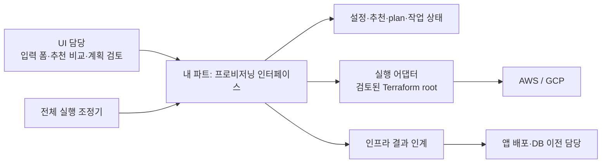
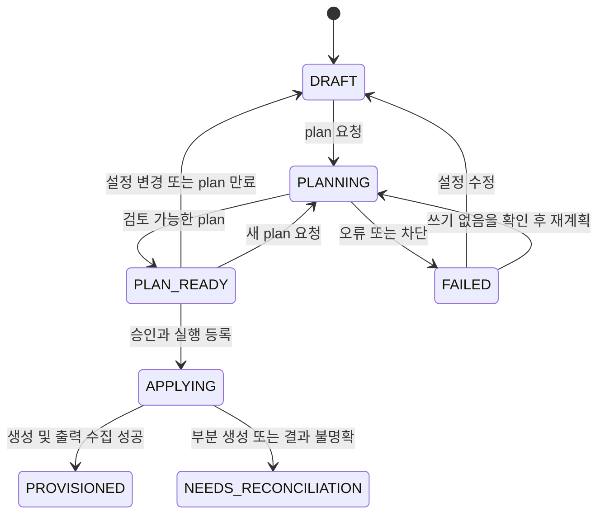

# 프로비저닝 모듈 인터페이스 v0.1 — 팀 검토용 초안

**목표:** UI와 마이그레이션 실행 조정기가 Terraform 내부를 몰라도, 사용자 설정 → 사양 추천 → 계획 검토 → 환경 생성 → 결과 인계를 요청할 수 있게 한다.

**현재 상태:** 인터페이스 명세·요청/응답 예시만 제공한다. HTTP 서버, 인증, 작업 저장소, Worker, 승인 기능은 아직 구현하지 않았다. 기존 Terraform 모듈과 `render_inputs.py`는 구현되어 있다.

## 한눈에 보는 책임



| 담당 | 제공할 것 | 이 명세에서 요구하는 연결 |
|---|---|---|
| **프로비저닝 담당** | 입력 스키마, 템플릿, 사양 카탈로그, 검증 규칙, plan/apply 작업 계약, 자원 출력 | 이 문서와 OpenAPI |
| UI 담당 | 폼, 추천 선택, 계획 검토, 진행 상태 표시 | 스키마·allowed_actions를 소비. Terraform/HCL 생성 금지 |
| 플랫폼 공통 담당 | 로그인/조직 권한, 클라우드 연결·비밀 참조, DB/큐/Worker 배포 환경 | 사용자 컨텍스트와 허가된 참조를 전달 |
| 전체 실행 조정기 | 단계 순서, 후속 모듈 호출 | job 완료 확인 후 handoff를 앱/DB 담당에게 전달 |
| 앱 배포 담당 | 컨테이너 런타임/배포, 설정·시크릿 연결, health check | compute/identity/network 정보 사용 |
| DB 이전 담당 | SQL 권한·스키마·복제 경로·데이터 이전 | database/cache 정보 및 pending_checks 사용 |

별도 마이크로서비스 구축은 전제하지 않는다. 플랫폼 API 안에 이 인터페이스를 구현하고, 느린 작업은 Worker로 분리할 수 있다. HTTP 경로는 `/api/v1/provisioning` 아래에 두는 제안이다.

## 구현 범위와 경계

v0.1은 **새 PoC/dev 배포 생성**을 다룬다. 프로덕션 운영 보장, 기존 자원의 수정/삭제·import, 자동 원복, 데이터 복제·앱 배포, 이미지 빌드는 포함하지 않는다. plan에 `UPDATE`, `DELETE`, `REPLACE`가 나타나면 v0.1에서는 `BLOCKED`로 반환한다. 단순 서버 사양 변경도 기존 운영 자원을 바꾸는 작업이면 후속 버전 범위다.

대상 구성은 이미 준비된 AWS/GCP root만 선택한다. 임의 Terraform 코드, Git URL, provider, shell 명령, `user_data`, 실행 파일 경로를 요청으로 받지 않는다.

## UI와의 계약

### 1. 템플릿 조회

`GET /templates/{template_id}/versions/{version}`은 다음을 반환한다.

- `input_schema`: 독립적인 JSON Schema 2020-12. 타입·필수 항목·enum·상한·기본값과 `x-ui` 표시 정보를 포함한다.
- `default_inputs`: 입력 시작점. 예시 파일의 계정·프로젝트·bucket·만료일은 실제 환경 값으로 바꿔야 한다.
- `fixed_rules`: DB 비공개, 캐시 TLS/AUTH, 객체 저장소 공개 차단 등 설명용 고정 규칙.
- `image_profiles`: 등록된 VM 베이스 이미지 후보. Packer 이미지 또는 검토한 공식 이미지 모두 가능하다.
- `lifecycle`: `DRAFT / APPROVED / RETIRED`. 초안 템플릿은 폼 작업만 가능하고 live plan/apply는 막는다.

`x-ui.editable_by`는 UI 표시 힌트다. 서버가 실제 권한을 재검사해야 한다. `editor`는 일반 입력과 사양을, `infra_admin`은 네트워크·공개 범위·삭제 보호 변경을 할 수 있다. `infra_admin`은 editor 권한도 갖는 것으로 제안한다. create 요청에서도 기본값과 다른 관리자 필드는 서버가 검사한다.

AI 추천 가능 항목은 `sizing` 안의 카탈로그 항목뿐이다. UI가 선택지를 숨기는 것만으로 정책을 강제하지 않는다. API의 스키마 검사, 의미 검사, Terraform validation을 모두 거친다.

### 2. 설정 초안 생성·수정

설정에는 다음 다섯 범주가 있다.

| 필드 | 의미 | Terraform과 연결 |
|---|---|---|
| template_id/version | `aws-web/v0.1` 또는 `gcp-web/v0.1` | 서버 등록표의 root 경로·Git revision·provider lock |
| cloud_connection_id | 플랫폼의 허가된 클라우드 연결 참조 | 실행 시 단기 credentials. 비밀값을 반환하지 않음 |
| image_profile_id | 승인된 VM 이미지 프로필 | AWS 리전별 `ami_id` 또는 GCP `image`로 해석 |
| secret_bindings | secret 참조만. AWS는 `redis_auth`, GCP는 현재 빈 객체 | AWS `TF_VAR_redis_auth_token`에 주입 |
| inputs | 사람 설정 + sizing + metadata | 기존 tfvars에 대응 |

API는 클라우드 credential, DB/Redis 비밀번호를 문자열로 받지 않는다. 참조 ID도 존재 여부뿐 아니라 **호출자가 해당 연결·이미지·secret을 사용할 권한**을 확인한다. 요청의 account/project와 연결된 실제 대상이 다르면 거부한다.

VM 이미지 프로필은 리전/프로젝트별 구체적 이미지 ID와 OS·아키텍처·검증 상태를 내부에 저장한다. 배포 실행 시 최신 이미지 검색이나 family 재해석은 하지 않는다. 선택한 프로필 revision과 해석된 이미지 ID를 plan에 고정한다. 현재 사양 목록은 x86_64 프로필만 지원한다. 컨테이너 앱 이미지 digest는 앱 배포 담당의 입력이며 이 요청에는 없다.

`PUT /deployments/{id}/configuration`은 전체 configuration을 교체한다. 일부 필드 누락을 기본값 초기화로 해석하지 않는다. `expected_revision`이 현재 값과 일치해야 하고 성공하면 revision을 1 증가시킨다. template_id/version, cloud_connection_id, cloud-native deployment_id는 생성 후 불변이다. 다른 대상은 새로운 deployment를 만든다.

v0.1의 서버 초안은 필수 입력이 모두 있는 snapshot이다. 입력 중인 불완전한 폼은 UI 로컬 상태로 유지하고, 필수 입력과 참조가 준비되면 POST/PUT으로 저장한다. 서버 측 부분 입력 자동 저장은 후속 범위다.

### 3. AI 추천과 사용자 선택

추천 요청은 현재 revision과 사용자 요구사항을 받는다. Worker는 해당 revision의 snapshot과 허용 카탈로그로 추천을 만들고, 형식·필드·값을 검사한 결과만 저장한다. AI에 credentials·secret·state를 전달하지 않는다.

추천 결과에는 `based_on_revision`, 변경 전후 값, 이유, 부족한 정보가 있다. 근거 부족 시 `NEEDS_INPUT`과 questions를 반환하고 설정을 변경하지 않는다. 임의 confidence 점수로 실행을 허용하지 않는다.

사용자는 `recommendation-acceptances`에 recommendation_id와 selected_fields만 보낸다. 서버는 저장된 추천값을 꺼내 선택한 필드만 기존 sizing에 병합한다. 사용자가 요청에 새 값을 끼워 넣을 수 없다. 추천의 based_on_revision과 현재 revision이 다르면 409이며, 성공하면 revision이 증가한다. 직접 다른 값을 선택하려면 configuration 수정 API를 사용한다.

## 최소 HTTP 인터페이스

자세한 타입은 [OpenAPI](../contracts/provisioning.openapi.yaml), 요청·응답은 [예시 목록](../contracts/examples/index.json)에 있다.

| 호출 | 결과 | 목적 |
|---|---|---|
| GET `/templates` | 200 TemplateList | 템플릿 선택 |
| GET `/templates/{id}/versions/{version}` | 200 Template | 폼·고정 규칙·이미지 후보 |
| POST `/deployments` | 201 Deployment | 초안 생성 |
| GET `/deployments/{id}` | 200 Deployment | 설정·현재 가능한 행동 |
| PUT `/deployments/{id}/configuration` | 200 Deployment | 전체 설정 교체 |
| POST `/deployments/{id}/recommendations` | 202 Job | 비동기 AI 추천 |
| POST `/deployments/{id}/recommendation-acceptances` | 200 Deployment | 선택한 추천 반영 |
| POST `/deployments/{id}/plans` | 202 Job | 계획 생성 |
| GET `/plans/{id}` | 200 Plan | 검토용 계획 조회 |
| POST `/deployments/{id}/apply` | 202 Job | 승인 기록 + 실행 등록 |
| GET `/jobs/{id}` | 200 Job | 진행·실패·결과 조회 |
| GET `/deployments/{id}/handoff` | 200 Handoff | 후속 모듈 인계 |

초기 UI는 2~5초 간격 polling이면 충분하다. Job에는 실제 phase와 메시지를 제공하며 근거 없는 진행률 %는 표시하지 않는다. RECOMMEND 완료는 recommendation, PLAN 완료는 plan_id, APPLY 완료는 handoff 조회할 deployment_id를 반환한다.

## plan 검토와 실행 승인

plan 응답은 민감값을 제거한 **모든 관리 자원의 변경 목록**, target_summary, 경고·차단 이유, expires_at, review_digest를 포함한다. 비용 계산은 이번 버전에서 `NOT_AVAILABLE`이며 0원으로 표시하지 않는다.

서버는 saved plan과 함께 다음을 고정한다: configuration revision/hash, 템플릿 Git revision, provider lock hash, 정책 revision, 이미지 프로필 revision/실제 이미지 ID, 연결 대상, secret 참조의 버전, state lineage/serial, saved plan hash. 비밀값 자체의 hash를 공개 검토 digest로 사용하지 않는다.

apply 요청은 `{expected_revision, plan_id, review_digest}`만 받는다. 서버는 아래 조건을 **잠금 안에서 원자적으로 검사하고 승인 기록 및 작업을 등록**한다.

1. 호출자에게 해당 배포의 `provision:apply` 권한이 있다. 승인자·시각은 서버가 정한다.
2. plan이 같은 배포의 최신 `REVIEWABLE` plan이며 만료 전이다. PoC 기본 유효기간은 15분으로 제안한다.
3. 요청 revision/digest와 저장된 값이 일치하고, 고정한 모든 실행 조건이 바뀌지 않았다.
4. 다른 실행 작업이 없고, plan에 차단 항목이 없다.
5. 검토된 **saved plan**을 실행한다. apply 시 새 plan을 만들어 대체하지 않는다.

조건 변경 시 `PLAN_STALE`로 새 plan을 요구한다. state 잠금과 Terraform의 stale-plan 검사도 유지한다. state serial만으로 out-of-band 클라우드 drift를 모두 감지할 수는 없다. 감지된 drift/외부 변경은 plan을 무효화하고, 미관측 drift와 apply 시점 API 실패 가능성은 남는 한계로 표시한다.

plan은 내부 비밀 artifact로 저장하고 raw plan/state·stdout을 UI에 직접 반환하지 않는다. revision 변경이나 새 plan 생성은 이전 plan을 무효화한다. UI에서 버튼만 비활성화하는 것으로 동시성 처리를 대신하지 않는다.

## 상태와 실패 처리



- `FAILED`: 자원을 변경하지 않은 검증/plan 실패. 오류 수정 후 새 작업 가능.
- `NEEDS_RECONCILIATION`: apply 실패·Worker 단절·결과 기록 실패 등 실제 자원 상태를 대조해야 하는 상황. 자동 destroy나 재apply 금지. v0.1의 수동 복구 절차에서 담당자가 state·클라우드·작업 기록을 대조해야 한다.
- `PROVISIONED`: 인프라 자원 생성과 출력 수집 완료. 앱 정상·DB 복제 준비·무중단 전환 완료를 의미하지 않는다. v0.1은 이후 configuration 수정/apply를 제공하지 않는다.
- 추천 작업은 deployment 상태를 바꾸지 않는다. 작업 종료 시 revision이 달라져도 결과는 기록하되 채택을 차단한다.

계획 생성 자체가 성공했지만 정책상 차단 항목이 있으면 PLAN job은 `SUCCEEDED`, Plan은 `BLOCKED`, Deployment는 `FAILED`로 기록한다. 실행 실패와 검토 불가를 구분해 UI에 blocker를 표시한다. handoff는 PROVISIONED 이전에 요청하면 409 INVALID_STATE다.

`allowed_actions`는 상태와 사용자 권한을 반영한 서버 결과다. UI는 이를 사용하지만 서버는 각 요청에서 다시 검사한다. PLAN/APPLY 중에는 configuration 수정과 추천 채택을 막는다. v0.1은 배포당 비동기 job 하나만 허용한다.

모든 변경 요청은 `Idempotency-Key`가 필요하다. 호출자·조직·method·path·key 범위에서 같은 본문은 최초 응답을 재사용하고 다른 본문은 `IDEMPOTENCY_CONFLICT`로 거부한다. 인증/권한 검사 후 idempotency replay를 revision 검사보다 먼저 처리한다. 동일 apply plan은 새 key를 써도 두 번 실행하지 않는다. dedupe 기록은 최소 배포 수명 동안 보존한다.

job 상태 조회의 실패와 실제 실행 실패는 다르다. UI 네트워크가 끊겨도 새 apply를 생성하지 말고 기존 job을 다시 조회한다. API 요청 제한과 권한은 연결된 플랫폼이 실제로 구현해야 한다.

## 인계 결과: 현재 Terraform과 연결

어댑터는 `terraform output -json handoff`의 객체만 추출하고, API deployment_id와 applied_revision을 붙인다. 전체 state를 내보내지 않는다. API의 `deployment_id`는 작업 레코드 ID이고 내부 `handoff.deployment_id`는 클라우드 자원 이름에 쓰는 입력 식별자다.

```json
{
  "deployment_id": "dep_aws_001",
  "applied_revision": 2,
  "readiness": "RESOURCES_CREATED",
  "container_runtime": "NOT_CHECKED",
  "handoff": "실제 응답은 AWS/GCP Handoff 스키마의 객체"
}
```

위는 구조 설명이며 완전한 JSON 예시는 contracts/examples에 있다. `handoff`에는 compute, database, cache, storage, network, metadata, pending_checks가 있다. RDS master secret ARN과 Redis 인증 전달 방식은 참조만 전달한다. handoff 조회는 `provision:handoff` 권한으로 제한한다.

현재 VM 생성 모듈은 컨테이너 런타임을 설치·검증하지 않는다. 이미지 프로필에 runtime 설치 정보가 있어도 실제 생성 VM 확인 없이 `READY`로 올리지 않는다. 후속 버전에서 검증 모듈과 완료 조건을 합의한 뒤 readiness를 확장한다.

## 구현 시 acceptance criteria

| 상황 | 기대 결과 |
|---|---|
| 사양 추천에 IAM/network 필드 삽입 | 입력/카탈로그 검사 실패, 설정 변화 없음 |
| 오래된 revision의 추천 채택 | 409 REVISION_CONFLICT |
| plan 검토 뒤 설정·이미지·secret 버전 변경 | 409 PLAN_STALE, 새 계획 필요 |
| 이중 클릭/응답 유실 후 동일 apply 재요청 | 같은 job 반환, 실행 한 번 |
| 다른 조직의 connection/secret/plan ID 전달 | 403 또는 범위가 숨겨진 404 |
| apply 도중 Worker 단절 | NEEDS_RECONCILIATION, 자동 재apply/destroy 없음 |
| 인프라는 생성됐지만 앱 미배포 | RESOURCES_CREATED + pending_checks, 앱 READY 표시 금지 |
| 실시간 비용 추정 없음 | NOT_AVAILABLE 표시, 0원 표시 금지 |

이 표는 향후 서버 구현의 인수 조건이다. 현재 테스트는 OpenAPI 구조·예시·입력 제약의 정합성을 검사하며 HTTP 서버의 동시성·권한·재시도를 검증한 것은 아니다.

## 팀이 정할 항목

1. 기존 플랫폼 backend에 구현할 담당자, Worker 실행 환경과 job 저장소. HTTP 계약은 먼저 소비 가능.
2. 조직/프로젝트 권한 모델과 `provision:*` 권한 이름의 매핑. 2인 승인 필요 여부는 별도 결정.
3. cloud_connection/secret/image-profile 레지스트리의 소유 주체. 예시는 가짜 참조이며 실제 항목 등록·승인이 필요.
4. 컨테이너 런타임 설치를 이미지 담당과 앱 배포 담당 중 누가 맡을지, readiness 확인 방법.
5. 부분 생성 실패의 담당자·수동 대조 절차, 기존 환경 update/destroy 지원 시점.

## 명세 변경·검증

```bash
python -m pip install -r requirements-contracts.txt
python tools/build_contract.py
python tools/build_contract.py --check
python -m unittest discover -s tests -v
```

OpenAPI/예시는 `tools/build_contract.py`가 생성한다. 사양 후보는 기존 `catalog/sizing-policy.json`을 읽고, 입력 시작점은 기존 tfvars 예시를 사용한다. 생성물을 직접 수정하지 않는다. 이 파일은 [OpenAPI 3.1](https://spec.openapis.org/oas/v3.1.0.html) 형식이며 문서 뷰어·클라이언트 코드 생성의 입력으로 사용할 수 있다.
